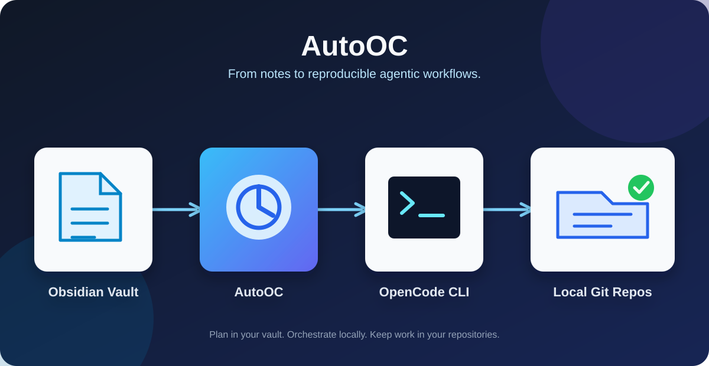

# AutoOC for Obsidian



AutoOC is a desktop-only Obsidian plugin for scheduling and running OpenCode, Codex, and GitHub Copilot CLI tasks and visual workflows from an Obsidian vault.

## What It Does

- Create OpenCode tasks with manual, one-time, daily, weekly, monthly, or interval schedules.
- Run tasks manually, monitor their status and output, keep logs, configure timeouts, and stop running work.
- Load available OpenCode models and agents, launch an OpenCode CLI session, and run a diagnostic from Obsidian.
- Build workflows in the embedded Visual Builder or classic view. Workflows support task, delay, and JavaScript code steps; default, forced, conditional, and AI-evaluated transitions; and branching paths.
- Import and export task and workflow packages as JSON, and use the included library packages as examples.
- Secrets se ha retirado: sin gestión ni inyección de valores. Se conserva el archivo histórico y el enmascaramiento de valores conocidos cuando está disponible.

## Ejecuciones independientes

El editor clásico y Visual Builder permiten seleccionar `concurrency: "independent"` en una tarea o workflow. El valor ausente o `"exclusive"` conserva la ejecución exclusiva histórica. Un mismo host propietario admite hasta dos ejecuciones independientes; GUI y CLI delegada comparten ese límite, sin cola ni reintentos automáticos.

Las definiciones no pueden compartir tareas, directorios iguales o anidados ni metadatos Git (incluidas worktrees). Code con permisos de bóveda, archivos o terminal, las modalidades interactivas y las evaluaciones con modelo requieren exclusividad. Los motores no interactivos requieren espacios de trabajo físicos disjuntos. Esta política coordina tareas de confianza y no aísla sus efectos ni amplía permisos.

Cada ejecución conserva su `runId`, salida y parada. Las tarjetas muestran si el propietario local está verificado. Una reserva incierta permanece bloqueada para continuación o reconciliación oficial; su antigüedad no demuestra abandono. Si una CLI autónoma posee la instalación, abrir Obsidian conserva la vista de espera y al propietario original, sin iniciar tareas ni transferir la ejecución.

## Requirements

- Obsidian Desktop with Community plugins enabled.
- The CLI for your chosen engine installed and authenticated: OpenCode, Codex, or GitHub Copilot CLI.
- Windows, macOS, or Linux.

## Install

### From a release

Descarga el ZIP de la versión publicada y extrae su contenido en `<vault>/.obsidian/plugins/auto-oc/`. Debe contener los siete archivos: `main.js`, `manifest.json`, `styles.css`, `autooc-cli.cjs`, `autooc-runtime.cjs`, `skills/autooc-runtime/SKILL.md` y `release-integrity.json`. El paquete completo puede arrancar sin red.

Desde 1.6.0, usa la actualización del propio plugin. Al recibir los tres archivos del actualizador antiguo, el nuevo `main.js` completa automáticamente el paquete antes de habilitar ejecuciones. Necesita red para ese primer completado y exige la misma versión y los mismos bytes del bundle. Un fallo de red o integridad informa del problema y permite reintentar; una transacción incierta conserva su marcador y respaldo y bloquea ejecución. No borres reservas ni journals para forzar la carga. Esta corrección solo estará disponible por actualización pública cuando se publique la versión 1.6.2; prepararla en esta rama no acredita su publicación.

La recarga espera de forma acotada a que termine una escritura del catálogo iniciada por la vista antigua, tanto la escritura directa de 1.6.0 como el guardado atómico de 1.6.1. En este último caso observa la cola de guardados: solo admite un nuevo lock cuando ha comprobado que un temporal del guardado anterior pasó a ser el catálogo por renombrado atómico. Los avisos del directorio adelantan las comprobaciones, sin sustituirlas. Una transición no observada o incierta bloquea; tras terminar exige datos válidos y estables y fija su identidad. Un lock persistente, sustituido o inseguro, un cambio posterior del catálogo o efectos pendientes detienen el arranque sin sustituir datos por valores vacíos. Conserva la evidencia y el diagnóstico; no borres una reserva para forzar el reintento.

Reload Obsidian, then enable **AutoOC — OpenCode Task Scheduler** in **Settings > Community plugins**.

Si Obsidian usa una carpeta de configuración personalizada, instala el plugin en `<vault>/<configDir>/plugins/auto-oc/`. Las tareas y workflows compartidos usan el catálogo, la reserva, el journal, la recuperación y las aprobaciones de esa instalación. Si cambias la selección con una reserva activa, AutoOC rechaza la discrepancia: termina o reconcilia la ejecución y recarga Obsidian. La CLI conserva `.obsidian/plugins/auto-oc` como ubicación predeterminada; no busca otras instalaciones.

### Local development

```powershell
npm install
npm run build
node deploy.mjs "C:/path/to/your/vault"
```

`node deploy.mjs` copia los siete artefactos ya compilados a `<vault>/.obsidian/plugins/auto-oc/`, conservando configuración e historial. Ejecuta antes `npm run build` y descarga el plugin sin ejecuciones pendientes. Usa `npm run dev` para compilación iterativa y `npm run build` para generar el paquete verificable.

For iterative bundling, run:

```powershell
npm run dev
```

## Use AutoOC

1. Open the AutoOC panel from its ribbon icon or command palette command.
2. Create a task, select an OpenCode model and schedule, then save it.
3. Choose **Run** to execute immediately or let the scheduler run it when due.
4. Review output and logs in the panel; use **Stop** to cancel an active task.

AutoOC ejecuta OpenCode como proceso local. Obsidian guarda las tareas y workflows en los datos del plugin de la bóveda. El archivo histórico de credenciales se conserva sin modificar en la carpeta del plugin. Consulta la [arquitectura](docs/architecture.md) para ver los recorridos de ejecución y datos.

### GitHub Copilot CLI

1. Install [GitHub Copilot CLI](https://docs.github.com/en/copilot/how-tos/copilot-cli/set-up-copilot-cli) and sign in from a terminal using `copilot login`. Your account and organization must permit Copilot CLI access.
2. In AutoOC settings, use **Copilot executable path → Detect & test**. The default `copilot` detects the local installation, including the native executable bundled by npm on Windows. You can also specify an absolute executable path. This check verifies the installation; account access is checked when a task runs.
3. Create a **GitHub Copilot CLI task** in the classic editor or Visual Builder. Enter its prompt, project folder and schedule. Optionally enter a model ID available to your account (`/model` in Copilot lists them). Empty uses AutoOC's **Default Copilot model**, then the CLI default.
4. Tasks expose only file reading and search tools by default. Enable **Allow tools automatically** on a task to let Copilot edit files and run commands without asking. Folder and URL permissions still follow Copilot's policy. This permission is included in exported packages, so review it before running imported tasks.
5. Run the task and follow its output in AutoOC. **Stop**, timeouts, recurring schedules, saved logs, and workflow output handoff are supported. Copilot tasks can share a workflow with OpenCode, Codex and JavaScript steps.

Copilot tasks run in the background using the selected folder's currently checked-out branch. They do not open an interactive terminal, use OpenCode agents/Ralph Loop, or change branches automatically. AI-evaluated workflow transitions still use the existing OpenCode evaluator. Long prompts use a temporary UTF-8 instruction file that is removed when the task ends. AutoOC no inyecta valores del almacén retirado; mantiene el enmascaramiento histórico aplicable en el plugin.

Exports containing Copilot tasks use schema `1.6.0` and `taskKind: "copilot"`; older schemas remain supported. As with other engines, exported packages use the importing system's default model. See the included [Copilot example](library/copilot-code-review.json).

If a task reports **Access denied by policy settings**, check your [Copilot account settings](https://github.com/settings/copilot) and organization policy. AutoOC cannot override GitHub's access restrictions.

## Visual Builder

Open the command palette and select `Open AutoOC Visual Builder`. The modal is titled `✨ WF Visual Builder`. Build workflows with task, delay, and JavaScript code steps, then connect them with transitions to create DAG branches. The embedded builder validates and applies workflow state to AutoOC; import and export workflow JSON remain in the classic AutoOC panel.

The classic AutoOC view and Visual Builder edit the same tasks and workflows. Use either surface for the workflow that best fits the job.

## Ralph Loop

For tasks that should continue until their completion criteria are met, enable Ralph Loop in the task editor. AutoOC prefixes the task prompt with `/ralph-loop`; the OpenCode Ralph Loop stops when it emits `<promise>DONE</promise>` or reaches its maximum iterations. Make the done criteria explicit in the prompt. Set it up from the command palette with `AutoOC: Ralph Loop Assistant (install/activate)`, then restart OpenCode.

## Retirada de Secrets y AutoOC MCP

Secrets se ha retirado del producto: no hay controles de gestión, revelado, copia ni PIN, y ningún lanzamiento recibe automáticamente sus valores. El archivo histórico `secrets.vault.json` se conserva sin borrarlo, reescribirlo, migrarlo ni exportarlo. La autenticación propia de OpenCode, Codex y Copilot y el entorno ordinario del proceso mantienen su contrato.

`requiresAutoOCSecrets: true` se conserva al cargar, importar, exportar y editar tareas, workflows y pasos antiguos. Todos los hosts rechazan una dependencia declarada antes del primer efecto, incluida una tarea posterior a un paso Code; hay que adaptar la definición. El indicador no detecta dependencias ocultas en prompts o scripts.

El plugin mantiene un componente interno de solo lectura para enmascarar valores históricos conocidos de cuatro o más caracteres antes de mostrar o persistir salidas. Requiere que Electron safeStorage pueda descifrarlos; si el archivo es ilegible o el descifrado falla se avisa sin contenido sensible y sin sobrescribirlo. No protege universalmente credenciales externas ni acredita enmascaramiento en el host autónomo, que no accede al almacén cifrado.

El puente MCP local se retira en 1.6.2 para eliminar su carrera de arranque y descarga. AutoOC no modifica configuraciones ni credenciales de otros clientes. La ejecución autónoma sigue disponible con la CLI y la [skill distribuida](skills/autooc-runtime/SKILL.md). El almacén de credenciales existente se conserva.

## CLI con Obsidian abierto

En un paquete que indique `pluginRequests: 1` al consultar `version`, la CLI puede pedir al plugin abierto que ejecute una tarea o workflow. Abre el Dashboard para ver su progreso y resultados. Se usan los mismos comandos:

```powershell
node "C:/ruta/vault/.obsidian/plugins/auto-oc/autooc-cli.cjs" run --vault "C:/ruta/vault" --task ID_TAREA
node "C:/ruta/vault/.obsidian/plugins/auto-oc/autooc-cli.cjs" run --vault "C:/ruta/vault" --workflow ID_WORKFLOW
```

El plugin y la CLI deben pertenecer al mismo paquete compatible. Con Obsidian abierto, el plugin mantiene la reserva y ejecuta la petición; con el plugin descargado y sin reserva, la CLI ejecuta directamente. El resultado final es JSON por stdout y el progreso delegado se informa por stderr. No se habilitan ejecuciones simultáneas ni se abre ningún puerto de red. Cerrar solo el Dashboard no detiene la tarea.

Para observar la ejecución en el Dashboard, carga AutoOC antes de lanzar la CLI. Si la CLI ya está ejecutando autónomamente, abrir Obsidian no transfiere esa ejecución al plugin: la reserva sigue protegida hasta terminar o reconciliar.

Desde 1.6.7, el Live Log de OpenCode no interactivo muestra la respuesta y la traza mientras el proceso sigue trabajando, tanto si se inicia desde Obsidian como desde la CLI. La salida intermedia es temporal; el resultado final se guarda al terminar.

1.6.7 también hace cooperativas la carga y persistencia de catálogos grandes y permite editar texto/código de pasos existentes con `export-workflow` y `edit-workflow`, usando el hash esperado y la skill portable, sin cerrar Obsidian. Una ejecución activa conserva su exclusión y las ediciones concurrentes se detectan antes de guardar.

Si la CLI ya tiene la reserva al abrir Obsidian, AutoOC espera y vuelve a cargar tras su liberación normal estable. No elimina reservas ni repite tareas. Consulta [las notas de 1.6.7](RELEASE_NOTES_1.6.7.md) para el alcance y las validaciones pendientes.

`stop`, `resume` y `reconcile` conservan el ID de ejecución. Si se interrumpe la espera o se cierra Obsidian, consulta `status` y el recibo indicado antes de repetir; una entrega incierta nunca se convierte automáticamente en otra ejecución. Esta capacidad preparada en el repositorio no acredita su publicación o instalación.

## Diagnostics And Troubleshooting

Run `AutoOC: Diagnostic — test opencode command` from the command palette to check the configured OpenCode command. For setup failures, task launch problems, or timeouts, review the [architecture](docs/architecture.md) and verify the configured OpenCode command, task timeout, and plugin files under `.obsidian/plugins/auto-oc/`.

## Development

```powershell
npm test
npm run build
```

`npm test` runs the repository's Node test suite. The build first inlines the Visual Builder, type-checks TypeScript, and bundles the Obsidian plugin. The primary source is `main.ts`; edit `util/ui_workflow_builder/index.html` for the standalone builder. Its generated embed is refreshed by the development and build scripts.

The commands in this README are the authoritative command reference for implementation, contributor workflow, generated-file relationships, and quality gates.

## Release Artifacts

Crea el ZIP distribuible con los siete archivos enumerados en Instalación:

```powershell
npm run build
npm run pack:release
```

El paquete se guarda en `release/auto-oc-<version>.zip` y el script imprime su SHA-256. El descriptor verifica los seis artefactos restantes, su versión y sus hashes. Consulta el [workflow de publicación](RELEASE_WORKFLOW.md), la [lista de comprobaciones](PUBLISH_CHECKLIST.md) y el [changelog](CHANGELOG.md).

## Contributing

Contributions, bug reports, and workflow ideas are welcome. Preserve these invariants:

- Keep the classic AutoOC UI and Visual Builder consistent.
- Preserve task and workflow import/export compatibility, migrations, and JSON round trips when changing persisted workflow data.
- Regenerate Visual Builder output and release assets when their sources change.
- Run `npm test` and `npm run build` before submitting changes.

Start with the [architecture](docs/architecture.md).

## License

AutoOC is open source under the [MIT License](LICENSE).

## Actualización de históricos bloqueados (1.6.6 / 1.6.7 → 1.6.9)

Si el actualizador informa de efectos inciertos y `abandon` rechaza una ejecución
terminal, usa el paquete completo **1.6.9** desde una carpeta independiente.
Verifica su procedencia oficial antes de ejecutarlo. Esta guía prepara la nueva
versión; no acredita que esté publicada ni instalada en tu bóveda.

1. Descarga AutoOC normalmente desde Obsidian (desactivar el plugin). Una reserva
   que permanezca bloquea el procedimiento: no borres locks ni journals.
2. Desde el ZIP extraído, ejecuta:
   `node autooc-cli.cjs maintain-release --vault "C:/ruta/vault" --inspect`.
   La inspección no modifica la instalación y muestra identidad física, revisión
   y causas, sin prompts ni resultados privados.
3. Guarda en un JSON privado una **lista** con únicamente las inspecciones de las
   ejecuciones revisadas. Conserva todos sus campos; añade a cada objeto
   `"reason":"motivo humano concreto"` y `"acknowledgedUnknownEffects":true`.
   No selecciones ejecuciones de otra bóveda ni infieras decisiones globales.
4. Ejecuta desde esa misma carpeta:
   `node autooc-cli.cjs maintain-release --vault "C:/ruta/vault" --decisions "C:/ruta/decisiones.json"`.
   Comprueba el recibo: informa del respaldo privado verificado y de cada decisión
   durable, e instala los siete artefactos con la reserva del destino.
5. Activa AutoOC normalmente y comprueba la versión, historial y una nota testigo
   guardada/reabierta. El recibo de instalación **no acredita carga en Obsidian**.

La fase histórica, pasos y resultados se conservan; el resultado externo sigue
siendo **desconocido**, incluso tras resolver el bloqueo administrativo. La
decisión no detiene procesos, confirma su terminación ni repite pasos. Si queda
otro histórico incierto o una escritura pendiente, la instalación se detiene.
Los lectores antiguos aceptan el campo añadido y mantienen su bloqueo prudente.
No se necesita un comando nuevo en la CLI antigua.

Desde 1.6.9, el mantenimiento también reconoce un abandono oficial ya registrado
cuando el catálogo conserva los vínculos anteriores del mismo intento. Verifica
el snapshot original completo, identidad, hash histórico, revisión, fase y pasos;
no modifica esos vínculos ni vuelve a registrar el abandono. Si no quedan otras
incertidumbres por decidir, guarda `[]` en el archivo de decisiones después de
una inspección nueva. El resultado externo permanece `unknown` y `applied` queda
vacío. Un snapshot ausente, inseguro o incoherente, otro intento sin resolver,
una reserva o una escritura pendiente bloquean el procedimiento. No edites el
catálogo o la evidencia para sortear ese diagnóstico.

Si hay un fallo parcial, conserva el recibo, el respaldo y los snapshots.
Las decisiones durables permanecen; vuelve a inspeccionar y selecciona solo los
casos aún pendientes (lista `[]` explícita si todas las decisiones ya son durables). Si queda `update-pending.json`, utiliza la recuperación
soportada del instalador antes de ejecutar más trabajo. No edites sus registros.

## Guardados interrumpidos (candidato local)

El candidato añade `inspect-settings-write --vault <ruta-absoluta>` y
`recover-settings-write --vault <ruta-absoluta> --decision <JSON-absoluto>`.
Comprueba `version` y `help` de la CLI seleccionada por ruta absoluta antes de
usarlos: no se presupone que una instalación anterior los incluya. La inspección
no escribe y devuelve identidades, hashes y motivos de bloqueo, sin contenido
del catálogo. La decisión requiere revisión expresa de esa inspección; su
esquema y los límites están en [la guía del runtime](skills/autooc-runtime/SKILL.md#inspección-y-recuperación-explícita-de-guardados-candidato).
La recuperación crea un respaldo verificado y archiva la evidencia. Conserva
catálogo, checkpoints y reserva; la reanudación es otra acción independiente.

Al cerrar o recargar mientras AutoOC guarda, el plugin mantiene abierta la
ventana hasta terminar. El aviso indica cuándo puedes repetir el cierre o la
recarga. Si el proceso termina forzosamente, el siguiente arranque puede
archivar el guardado interrumpido únicamente con una prueba durable vinculada
al propietario ausente, al directorio y a las huellas del catálogo.

La recuperación conserva el último `data.json` confirmado y los temporales en
`runtime/settings-write-recovery-TOKEN`, con recibo verificable. No promueve
temporales ni reanuda tareas. Un propietario vivo o no verificable, archivos
alterados, mantenimiento pendiente o ejecuciones inciertas siguen bloqueando.
Los bloqueos antiguos sin esta prueba requieren recuperación explícita; no se
retiran por antigüedad. Un corte eléctrico puede dejar metadatos incompletos y
seguir requiriendo intervención. Esta protección pertenece al candidato de la
rama de desarrollo; la versión publicada 1.6.9 permanece sin cambios.
