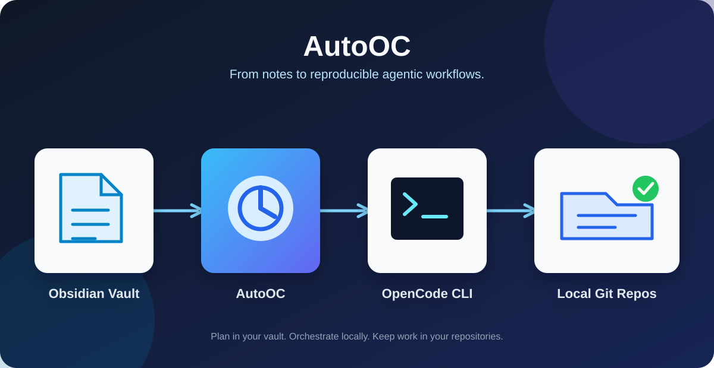

# AutoOC for Obsidian



AutoOC is a desktop-only Obsidian plugin for scheduling and running OpenCode, Codex, and GitHub Copilot CLI tasks and visual workflows from an Obsidian vault.

**Automation and agents:** [complete CLI reference: commands, parameters, and examples](#complete-autooc-cli-reference).

**CLI 1.7.26 (candidato):** [cola en segundo plano, reconexión por requestId/runId y tiempos por fase](Docs/cli-reliability.md). `inspect-request` y `follow` consultan la misma ejecución tras perder el heartbeat; no la relanzan. La validación real con Obsidian visible, inactivo y minimizado sigue pendiente.

**Update blocked?** [Install the new version while keeping your tasks, workflows, and history](#update-blocked-install-without-losing-your-data).

**Development tracking:** [1.7.13 delivery record: changes, flows, contracts, limitations, and release preparation](docs/autoOC/04_Desarrollo/entrega-1.7.13-20261101/README.md) (in Spanish).

**Candidato 1.7.22:** [terminales independientes, Settings ordenados y límites de validación](docs/autoOC/04_Desarrollo/settings-ordenados/Notas_version-1.7.22.md).

**Páginas y worktrees (candidato):** [recorrido para desarrollar, usar la CLI y cerrar el trabajo](docs/work-pages.md).

## Area dashboard

**Nombres de tareas (1.7.24):** al renombrar una tarea, WorkFlows y Dashboard muestran el nombre actual en sus referencias. Los alias de paso se conservan y se muestran junto al nombre de la tarea. [Comportamiento y compatibilidad](docs/workflow-task-names.md).

Since 1.7.12, **Dashboard** groups workflows and tasks by their **Area** field, with a **No area** group for unassigned items. To reorganize them, change their area in the editor or through the selection actions. Positions from the previous map remain saved in the settings.

Debajo de **Your areas**, pulsa **Workflows** o **Tasks** para mostrar solo ese tipo en sus respectivas áreas; **Tasks** incluye las tareas Code. **All** restaura la vista conjunta. El filtro se combina con la búsqueda, **Needs attention** y **Show disabled**, conserva las áreas plegadas y se mantiene durante la sesión del panel. Los contadores de estos botones indican el total del catálogo, incluidos los elementos desactivados.

Each item has a bubble and a visible name: a double ring for workflows, a terminal icon for AI tasks, and **{ }** for Code. Select a workflow to see its steps, including Code and delays, then select a step to access **Log**, **History**, or **Open controls**. The latter opens the usual run, stop, edit, and disable controls. A workflow's log belongs to its current step; steps have their own results and are not considered completed simply because the workflow finished.

Search includes step and area names. **Needs attention** filters recorded issues; **Show disabled** displays disabled items in gray. Each area can be collapsed, and **Collapse areas / Expand areas** apply to all groups. Selection, search, and collapsed groups persist during the panel session. Las burbujas de tareas y pasos tienen un diámetro fijo de **30 px**, sin ajuste en Settings y sin cambiar el tamaño de las letras. Las preferencias antiguas se conservan pero no se aplican.

Since 1.7.13, a run controlled by this instance shows **Running** without turning internal recovery markers into warnings. AutoOC checks the identity of that specific attempt; having Obsidian open is not enough. Warnings for pending approval, an unconfirmed stop, failure, or unconfirmed control remain visible.

Counters distinguish top-level items from running steps. They show recorded state, not an independent check of process activity. The panel updates through existing events, preserves scroll positions, and initially limits visible steps to 40, with **Show more steps** to expand the list. It adds no polling or continuous motion, only a brief indication when a status changes, respecting reduced-motion preferences.

## Open an interactive CLI

### Settings organizados (candidato de desarrollo)

Settings agrupa las opciones existentes en **General**, **Harnesses**, **Terminals**, **Execution**, **Logs**, **Library** y **Maintenance**, con navegación y secciones plegables. Se mantienen las opciones salvo el tamaño de burbujas, retirado expresamente para fijar tareas y pasos a 30 px; no se migran preferencias. En **Harnesses**, cada motor reúne su ejecutable, visibilidad y defaults compatibles; Claude sigue siendo una CLI interactiva, no un motor nuevo de tareas de fondo. **Check version** está disponible para los cinco harnesses y no acredita autenticación.

OpenCode 2 ofrece también tablas y recarga de sus propios modelos/agentes por ejecutable y proyecto. Las listas no se consultan automáticamente al abrir Settings ni se mezclan con las de OpenCode 1. El modo interactivo predeterminado existente se identifica para OpenCode 1 y 2. Ralph Loop sigue visible dentro de OpenCode 1, sin prometer compatibilidad con los demás. Esta organización en fuentes no acredita su instalación ni aceptación visual en Obsidian.

OpenCode 1 and OpenCode 2 are configured as separate engines, with their own executable paths, models, and agents. **Check version** identifies the installation, and existing tasks keep their engine. See the [OpenCode 2 guide](docs/opencode-2.md) for automated tasks, interactive sessions, and drafts.

**💻 CLI** brings together OpenCode, Codex CLI, GitHub Copilot CLI, and Claude Code. The selector shows available executables you have enabled and lets you open the project folder or choose another folder.

In **Settings → AutoOC → Harnesses**, enable the launchers you want and configure their executables. **Auto-detect** searches `PATH` first; you can also enter an absolute path without arguments. OpenCode, Codex, and Copilot share these paths with their tasks. Claude Code is an interactive launcher; it does not add a scheduled task type. Shared destination and support are under **Terminals → Interactive CLI launchers** (previous builds grouped paths there too).

Each session opens directly in a terminal and uses that CLI's own authentication, model, and approvals. Codex starts as `codex`, without opening the desktop application; Claude uses `claude`, its [official interactive entry point](https://code.claude.com/docs/en/cli-reference). AutoOC adds no prompts or automatic permissions. These sessions do not create tasks or acquire the scheduler's execution lease; manage them from their terminals.

If an executable is missing or disabled, the dialog offers **Configure CLIs**. **Working Directory** sets the initial folder; leaving it empty uses the vault. Linux retains the **Linux terminal emulator** setting. The previous Codex command keeps its identifier to preserve shortcuts and is now named **Open Codex CLI**.

## Codex: segundo plano, terminal y aplicación (candidato de desarrollo)

En **Settings → AutoOC → Harnesses → Codex CLI** hay un único ejecutable compartido.
La ruta explícita tiene prioridad; con `codex`, se busca primero en PATH, después
en ubicaciones conocidas y finalmente en la distribución de escritorio si existe.
En Windows, los shims npm oficiales se resuelven al binario nativo de la misma
instalación para todos los usos. Una instalación incompatible no se sustituye
silenciosamente por otra. Settings muestra la ruta efectiva; **Check version**
consulta versión y ayuda para comprobar si anuncia App Server. No prueba login ni
ejecuta una tarea, y al cambiar la ruta se invalida el diagnóstico anterior.

| Opción de tarea | Comportamiento |
| --- | --- |
| Codex CLI · background (App Server) | Ejecuta `codex app-server` sin necesitar la aplicación Codex abierta. |
| Codex CLI · App conversation (approvals) | Usa el mismo App Server y abre la conversación en la aplicación, conservando las aprobaciones y la espera del resultado del turno. |
| CLI task (interactive), harness Codex CLI | Abre una sesión de terminal con sus propios overrides o defaults nativos; completar el lanzamiento no acredita el resultado humano. |

Se conservan tipos, campos, modelos y permisos de tareas existentes. Las tareas
App Server requieren una CLI compatible; un shim Windows sin binario nativo se
rechaza con un diagnóstico antes de lanzar trabajo. Cerrar Obsidian no transfiere
las ejecuciones del plugin a la aplicación Codex. La CLI autónoma de AutoOC puede
iniciar ejecuciones compatibles sin Obsidian, bajo sus reglas de propiedad.

## Sacar una terminal de Obsidian (candidato de desarrollo)

En las pestañas de **AutoOC Terminals**, el botón **↗** abre la misma sesión en el navegador externo. Espera al aviso de conexión confirmada antes de reiniciar Obsidian o AutoOC. No se inicia otro agente ni se repite el prompt. La entrada pasa a la ventana externa; Obsidian conserva una vista de la salida mientras siga abierto.

Si la terminal integrada se dibuja mal, pulsa **↻** junto a **+**: recalcula su tamaño y repinta la pantalla sin reiniciar la sesión, limpiar la conversación ni enviar comandos al agente.

Las nuevas sesiones integradas usan un host Node independiente: requieren **Node.js 18+**, el soporte PTY instalado expresamente y **Windows x64 o macOS Intel/Apple Silicon**. En Mac, además del PATH heredado, se buscan Node y las dependencias de la CLI en Homebrew, carpetas habituales del usuario y la carpeta del ejecutable configurado. No se ejecutan perfiles de shell. Si usas un gestor de versiones cuya carpeta no se detecta, configura la ruta absoluta de la CLI y asegúrate de que Node esté disponible en esa carpeta o en PATH. El cliente externo se sirve solo en `127.0.0.1`, con una credencial privada por sesión y sin recursos web externos. No compartas su URL: permite controlar esa terminal.

**Configurar la terminal integrada en Mac:** en **Settings → AutoOC → Terminals**, pulsa **Download and install terminal support** y selecciona **Integrated in Obsidian** en **CLI terminal destination**. Configura los ejecutables en **Harnesses** y abre la CLI desde el panel. El soporte verificado incluye los binarios Intel y Apple Silicon, para admitir también un host Node de otra arquitectura bajo Rosetta; se conservan los permisos de ejecución de `spawn-helper`. No requiere Xcode, compilación local ni scripts npm. Actualizar AutoOC no instala este soporte automáticamente ni copia el instalado en otro ordenador. **Linux aún no dispone de PTY integrado** en esta versión; puede usar la ventana externa. El cambio conserva el esquema de tareas/workflows; la guía de creadores refleja las plataformas admitidas. La validación nativa en Mac del candidato debe consultarse en su expediente, sin confundir las pruebas con dobles con Obsidian real.

Solo las sesiones cuya salida al navegador se haya confirmado sobreviven a la descarga del plugin. Cerrar la pestaña del navegador desconecta la vista, no detiene el proceso; conserva la pestaña o su URL para volver a acceder. Usa **Detener sesión** para terminarlo. Si la apertura falla, mantén Obsidian abierto y vuelve a usar **↗**: no lances otra tarea. Las sesiones iniciadas con la arquitectura anterior no se transfieren en caliente; tampoco hay reintegración automática tras recargar el plugin. Esta capacidad en las fuentes no acredita instalación, publicación ni validación visual en Obsidian.

## Create from a description

In **New Task** and **New Workflow**, **Create with AI** opens a form where you describe the objective and choose an engine and model. It uses the integrated **WF Builder Prompt** and the configured CLI session; generation can be canceled.

Since 1.7.11, **Model** is a dropdown. It reuses loaded OpenCode 1 and Codex model lists and models used by tasks with the selected engine. OpenCode 2 and Copilot show their configured or previously used models without mixing engines. **Other model…** accepts a custom identifier; **Automatic (CLI default)** lets the CLI choose. Your selection is retained when switching engines within the form, used to generate the draft, and copied to tasks created with that engine. You can change each task's model afterward. Opening the selector does not query providers or change global settings.

When generation finishes, **Review in editor** opens the draft in the regular editor. Generated workflows are sequential, with 2–30 steps. **Edit draft task** lets you review task prompts, models, and permissions before selecting **Create Workflow**. New tasks are saved together with the workflow; canceling does not add them to the catalog. The initial schedule is manual, and additional code permissions remain disabled until reviewed.

If the response is invalid, authentication fails, or generation times out, the form retains your objective and lets you retry or change engines. Generation does not depend on the execution lease and does not run the generated tasks. OpenCode 1 needs a CLI supporting `run --pure`; OpenCode 2 uses `run --standalone`. Each engine requires its own installation and authentication.

## Multiple selection

**Tasks** also shows **Workflow code steps**: code stored directly inside workflows, with the step's name, source, area, and status. Their cards can be collapsed and provide **Run**, **Stop**, **Enable/Disable**, **Log**, **History**, and **Edit Code**, also within **WorkFlows**. **Run** executes only that step, with empty input and prior results, and preserves the full workflow's latest result. **Stop** interrupts the code and prevents that run from continuing; it does not undo effects or confirm that previously started external commands have ended. Interrupted attempts can be reviewed through **Review interrupted attempt**.

Code runs in a separate process so Obsidian and Stop remain responsive. It requires **Node.js 18 or later**, available in PATH or a common installation location; if missing, AutoOC reports it without executing the step. It leaves no temporary scripts in the vault. Disabling a step preserves its code, results, and history and blocks any workflow that needs it, just like a disabled task. **History** shows both individual and workflow attempts for that step. **Open workflow** opens the original for editing. Code and output previews load when expanded and are limited to 12,000 characters. Steps retain their identities; they are neither duplicated as catalog tasks nor included in catalog bulk actions.

The **Task source** filter offers **All items**, **Catalog tasks**, or **Workflow code steps** only.

In **Tasks** and **WorkFlows**, select **Select items** to show checkboxes and bulk actions. Check individual rows or use **Select visible** to select the current filter results. Selection persists when filtering and switching tabs; the counter identifies selected items outside the visible list. **Clear selection** clears both tabs. **Hide selection** hides the controls and clears all selections so none remain hidden.

- **Change area** applies an existing or new area; an empty field removes the area. It does not change the area of steps or other tasks in the workflow.
- **Export selected** opens export with that selection. Workflows automatically include the tasks they need.
- **Disable selected / Enable selected** disables or re-enables items after you review the list. You can also use **Disable / Enable** on each card.
- **Delete selected** shows the exact list before confirmation. It removes only the selected items and their saved catalog data, preserving execution records on disk. Export first if you want to keep the definitions. If a workflow needs a selected task, the dialog identifies it: select that workflow too or remove the reference in its editor. Active runs or attempts awaiting review must be resolved before modifying their definitions.

Changes are saved together. If items change after the confirmation opens, you must review the selection again.

Disabled items appear in gray with **Disabled**. They retain configuration, schedules, results, and history, but cannot start manually, on a schedule, or through the CLI. A workflow using a disabled task cannot start either: re-enable the task; steps are not skipped. Disabling a workflow does not disable its reusable tasks. **Enable** restores the saved schedule, which may run on the next scheduler check. Active runs or attempts awaiting review must finish or be reviewed before changing this setting. Disabled state survives export and import; older packages remain enabled by default.

## What it does

Since 1.7.5, Code tasks and steps display JavaScript with syntax highlighting. The editor includes line numbers, folding, matching brackets, search, and undo. **Indent code** adjusts draft indentation; **Wrap lines** fits lines to the available width. Tab and Shift+Tab change indentation, Ctrl/Cmd+F searches, and Ctrl/Cmd+Z undoes changes. Edits persist only when you save the form. Viewing or editing code does not execute it.

- Create OpenCode tasks with manual, one-time, daily, weekly, monthly, or interval schedules.
- Run tasks manually, monitor their status and output, keep logs, configure timeouts, and stop running work.
- Load available OpenCode models and agents, open configured interactive CLIs from the shared CLI selector, and run a diagnostic from Obsidian.
- Build workflows in the WorkFlows editor. Workflows support task, workflow, delay, and JavaScript code steps; default, forced, conditional, and AI-evaluated transitions; and branching paths.
- Import and export task and workflow packages as JSON, and use the included library packages as examples.
- Secrets has been removed: no secret management or value injection. The historical file is preserved, along with masking of known values when available.

## Workflows anidados (candidato de desarrollo)

En **WorkFlows**, selecciona un workflow existente en **Add existing workflow** y pulsa **Add Workflow Step**. También puedes cambiar la referencia de un paso existente. El padre espera a que el hijo termine; después aplica la transición del paso usando el éxito o fallo del hijo y su última salida. La programación propia del hijo se ignora en esta invocación.

El primer paso del hijo recibe la salida previa del padre como `input`. Cada invocación tiene sus propios `outputs`, con los IDs locales de sus pasos. Al volver, el padre ve una sola salida bajo el ID de su paso Workflow. Un hijo puede utilizarse varias veces y contener otros workflows. Se rechazan referencias ausentes o ambiguas, ciclos de anidamiento, más de 16 niveles y planes de más de 10.000 pasos internos. Los bucles de transiciones conservan el límite de ejecución habitual.

Padre e hijos comparten una ejecución durable y una reserva. **Stop**, **Resume** y **Reconcile**, incluida la CLI, se dirigen al padre y su `runId`. Los resultados internos confirmados no se repiten; un efecto interrumpido sin resultado sigue requiriendo reconciliación. Cambiar una definición descendiente invalida la continuación del intento anterior. Las tareas y workflows descendientes quedan reservados; las políticas explícitas más restrictivas se respetan. La desactivación y las dependencias retiradas se comprueban antes del primer efecto. Los permisos Code siguen siendo los declarados en cada paso, sin ampliarse por anidamiento.

El historial del padre contiene los pasos internos, y el catálogo muestra la salida y el estado del paso Workflow. La ejecución anidada no sustituye el historial independiente del hijo. Las exportaciones incluyen automáticamente hijos y tareas; usan el esquema `1.7.0` con `stepKind: "workflow"` y `workflowExportId`. Al importar, todas las referencias se traducen a nuevos IDs. Los formatos anteriores siguen admitidos.

El creador IA integrado sigue preparando un único workflow secuencial; se pueden añadir hijos existentes al revisar su borrador. La guía de paquetes sí describe el formato anidado. Esta ampliación en las fuentes no acredita publicación ni instalación en una bóveda real.

## Parallel tasks and workflows

Starting with the **1.7.16 development candidate**, tasks and workflows run in parallel by default, including within the same vault and using the same AI engine. There is no AutoOC limit by default. Existing items without an explicit concurrency choice inherit this behavior; saved explicit choices are preserved. Installing the update does not start any task.

In **Settings → AutoOC**, use **Default concurrency → Parallel in this vault** and **Maximum simultaneous runs → 0 → Apply** for unlimited parallel work. Enter a positive whole number to set your own limit. The limit counts tasks and workflows together across Play, schedules and delegated CLI requests; lowering it does not stop existing runs. Your computer and AI provider still impose their own capacity limits. At capacity, a new request is rejected; there is no automatic queue or retry.

Each task/workflow editor offers these choices:

| Choice | JSON field | Behavior |
| --- | --- | --- |
| Use vault default | Omit `concurrency` | Inherit `defaultConcurrency`; its default is `"parallel"`. |
| Parallel in this vault | `"parallel"` | Allow other parallel runs in the same folder or Git repository. |
| Run alone | `"exclusive"` | Reserve the installation until the run finishes. |
| Separate projects only | `"independent"` | Allow overlap only without shared folders, nested directories or common Git metadata. |

Parallel work coordinates trusted tasks: it does not isolate files or expand Code/provider permissions. Give concurrent tasks different output files to avoid overwriting each other's work. The same task cannot run twice, and workflows that reference the same reusable task cannot overlap. The workflow's policy applies to its steps; steps still follow their transitions in order. Interactive sessions and declared Git branch changes continue to require exclusive execution. Older releases do not understand `"parallel"`.

Each run keeps its own `runId`, output, history and stop control. Stopping one does not stop the others. A retained parallel attempt from the same owner still reserves its own tasks, but permits different parallel tasks; it retains its evidence and counts toward a finite capacity limit. After an owner restart, an unresolved attempt without verified admission context still needs the recovery controls described below. An uncertain lease remains blocked; age does not prove abandonment.

The plugin host accepts multiple delegated CLI requests. Separate standalone CLI processes still cannot take ownership of the same installation simultaneously. If a standalone CLI owns it, opening Obsidian preserves the waiting view and original owner without starting tasks or transferring the run. The local host descriptor advertises `sharedWorkspaceConcurrency: true` and `concurrentExecutions` (`0` means Unlimited). Vault preferences `defaultConcurrency` and `maxConcurrentExecutions` affect admission only and do not invalidate historical definition fingerprints. No CLI commands or parameters have been added.

## Requirements

- Obsidian Desktop with Community plugins enabled.
- The CLI for your chosen engine installed and authenticated: OpenCode, Codex, or GitHub Copilot CLI.
- Windows, macOS, or Linux.

## Install

If **Check updates** reports **Unfinished execution or uncertain effect requires reconciliation**, follow the [blocked-update guide](#update-blocked-install-without-losing-your-data). You do not need to uninstall AutoOC or reset your catalog.

### From a release

Download the published release ZIP and extract its contents into `<vault>/.obsidian/plugins/auto-oc/`. It must contain all seven files: `main.js`, `manifest.json`, `styles.css`, `autooc-cli.cjs`, `autooc-runtime.cjs`, `skills/autooc-runtime/SKILL.md`, and `release-integrity.json`. The complete package can start offline.

When upgrading from 1.6.0, use the plugin's built-in updater. After receiving the three files copied by the old updater, the new `main.js` automatically completes the package before enabling execution. This initial completion requires network access, the same version, and identical bundle bytes. A network or integrity failure reports the problem and allows retrying; an uncertain transaction retains its marker and backup and blocks execution. Do not delete leases or journals to force loading. This compatibility path is included in 1.7.13.

Reload waits for a bounded period for a catalog write started by the old view to finish, covering both direct writes from 1.6.0 and atomic saves from 1.6.1. For atomic saves it observes the save queue: a new lock is accepted only after confirming that a temporary file from the previous save became the catalog through an atomic rename. Directory notifications trigger earlier checks without replacing them. An unobserved or uncertain transition blocks startup; after completion, AutoOC requires valid, stable data and records its identity. A persistent, replaced, or unsafe lock, a later catalog change, or pending effects stops startup without replacing data with empty values. Preserve the evidence and diagnostic information; do not delete a lease to force a retry.

Reload Obsidian, then enable **AutoOC — OpenCode Task Scheduler** in **Settings > Community plugins**.

If Obsidian uses a custom configuration folder, install the plugin in `<vault>/<configDir>/plugins/auto-oc/`. Shared tasks and workflows use that installation's catalog, lease, journal, recovery, and approvals. If you change the selection while a lease is active, AutoOC rejects the mismatch: finish or reconcile the run and reload Obsidian. The CLI defaults to `.obsidian/plugins/auto-oc`; it does not search other installations.

### Local development

```powershell
npm ci
npm run build
node deploy.mjs "C:/path/to/your/vault"
```

`node deploy.mjs` copies the seven already-built artifacts into `<vault>/.obsidian/plugins/auto-oc/`, preserving settings and history. First run `npm run build` and unload the plugin with no pending executions. Use `npm run dev` for iterative bundling and `npm run build` to generate the verifiable package.

For iterative bundling, run:

```powershell
npm run dev
```

## Use AutoOC

1. Open the AutoOC panel from its ribbon icon or command palette command.
2. Create a task, select an engine, model, and schedule, then save it.
3. Choose **Run** to execute immediately or let the scheduler run it when due.
4. Review output and logs in the panel; use **Stop** to cancel an active task.

AutoOC runs the configured engine as a local process. Obsidian stores tasks and workflows in the vault's plugin data. The historical credentials file remains unchanged in the plugin folder. See the [architecture](docs/architecture.md) for execution and data flows.

### GitHub Copilot CLI

1. Install [GitHub Copilot CLI](https://docs.github.com/en/copilot/how-tos/copilot-cli/set-up-copilot-cli) and sign in from a terminal using `copilot login`. Your account and organization must permit Copilot CLI access.
2. In **Interactive CLI launchers**, configure **GitHub Copilot CLI executable**, using `copilot` for automatic detection or an absolute path. **Auto-detect** saves the detected path. Use **GitHub Copilot task defaults → Test Copilot installation → Detect & test** to check the installation; account access is checked when a task runs.
3. Create a **GitHub Copilot CLI task** in the task editor. Enter its prompt, project folder and schedule. Optionally enter a model ID available to your account (`/model` in Copilot lists them). Empty uses AutoOC's **Default Copilot model**, then the CLI default.
4. Tasks expose only file reading and search tools by default. Enable **Allow tools automatically** on a task to let Copilot edit files and run commands without asking. Folder and URL permissions still follow Copilot's policy. This permission is included in exported packages, so review it before running imported tasks.
5. Run the task and follow its output in AutoOC. **Stop**, timeouts, recurring schedules, saved logs, and workflow output handoff are supported. Copilot tasks can share a workflow with OpenCode, Codex and JavaScript steps.

Copilot tasks run in the background using the selected folder's currently checked-out branch. They do not open an interactive terminal, use OpenCode agents/Ralph Loop, or change branches automatically. AI-evaluated workflow transitions still use the existing OpenCode evaluator. Long prompts use a temporary UTF-8 instruction file that is removed when the task ends. AutoOC does not inject values from the retired secret store; applicable historical output masking remains available in the plugin.

Exports containing Copilot tasks use schema `1.6.0` and `taskKind: "copilot"`; older schemas remain supported. As with other engines, exported packages use the importing system's default model. See the included [Copilot example](library/copilot-code-review.json).

If a task reports **Access denied by policy settings**, check your [Copilot account settings](https://github.com/settings/copilot) and organization policy. AutoOC cannot override GitHub's access restrictions.

## Workflow editing

Create and edit workflows in **WorkFlows**. The WF Visual Builder has been removed; existing workflows, their steps and transitions, history, and JSON import/export are preserved. **Create with AI**, inside **New Task** and **New Workflow**, uses the integrated prompt to generate a draft from your objective; there is no separate **WF Builder Prompt** button.

## Ralph Loop

For tasks that should continue until their completion criteria are met, enable Ralph Loop in the task editor. AutoOC prefixes the task prompt with `/ralph-loop`; the OpenCode Ralph Loop stops when it emits `<promise>DONE</promise>` or reaches its maximum iterations. Make the done criteria explicit in the prompt. Set it up from the command palette with `AutoOC: Ralph Loop Assistant (install/activate)`, then restart OpenCode.

## Removal of Secrets and AutoOC MCP

Secrets has been removed from the product: there are no management, reveal, copy, or PIN controls, and no launch automatically receives its values. The historical `secrets.vault.json` file is preserved without deletion, rewriting, migration, or export. OpenCode, Codex, and Copilot authentication and the normal process environment retain their existing behavior.

`requiresAutoOCSecrets: true` is preserved when loading, importing, exporting, and editing older tasks, workflows, and steps. All hosts reject a declared dependency before the first effect, including a task after a Code step; the definition must be adapted. The flag does not detect hidden dependencies in prompts or scripts.

The plugin retains an internal, read-only component to mask known historical values of four or more characters before displaying or persisting output. Electron safeStorage must be able to decrypt them; if the file is unreadable or decryption fails, AutoOC warns without exposing sensitive content or overwriting the file. This does not universally protect external credentials or establish masking in the standalone host, which cannot access the encrypted store.

### An old vault shows a historical output masking notice

Starting with **1.7.17**, open **Settings → AutoOC → Legacy credential notice → Review**, or use the command **AutoOC: Review legacy credential notice**. This warning concerns the retired Secrets feature; it does **not** block a task or sign you out of your CLI. A separate execution error still needs its own resolution.

- **Try reading again** checks whether the old values can now be read. For encrypted values, the original operating-system account and secure storage may be needed; a damaged file needs a known-good backup. See [Electron's secure-storage behavior](https://www.electronjs.org/docs/latest/api/safe-storage).
- **Keep file and dismiss reminder** acknowledges that some old values still cannot be hidden in output. It saves only a preference on this device, without rewriting `data.json`, changing tasks or workflows, or deleting `secrets.vault.json`. Masking continues for readable values. The reminder stays dismissed for that exact file and problem; a changed file or different failure requires another review.
- If the file cannot be read at all, fix access to it and retry before dismissing the reminder. AutoOC must identify the file before saving an acknowledgment.

Repeated settings reloads with the same failure do not produce another reminder. A successful read clears the session's warning state. Settings keeps the review option available even after acknowledgment. A transient or partial failure also keeps the masks already known in that session. No passwords are recovered, exported, or injected into tasks by this feature, and dismissal does not restore unavailable masking.

The local MCP bridge was removed in 1.6.2 to eliminate its startup and unload race. AutoOC does not modify other clients' configuration or credentials. Standalone execution remains available through the CLI and the [distributed skill](skills/autooc-runtime/SKILL.md). The existing credentials store is preserved.

<a id="referencia-completa-de-la-cli-autooc"></a>

## Complete AutoOC CLI reference

The CLI distributed with the extension is **`autooc-cli.cjs`**. This reference covers **1.7.13**. Always check `version` and `help` for the installation you intend to use: an older CLI may not support newer options. This is not the provider CLI (OpenCode, Codex, Copilot, or Claude); the **CLI** button opens those interactive programs separately.

```powershell
$cliPath = 'C:/path/to/vault/.obsidian/plugins/auto-oc/autooc-cli.cjs'
$vaultPath = 'C:/path/to/vault'
node $cliPath version
node $cliPath help
node $cliPath list --vault $vaultPath
node $cliPath status --vault $vaultPath
```

Requires Node.js 18 or later. In the table, `CLI` is the absolute path to that file and `VAULT` is the vault's absolute path. **Prefix every call with `node CLI`** and quote paths containing spaces. The CLI selects `<VAULT>/.obsidian/plugins/auto-oc`; it neither searches alternative configuration folders nor provides a parameter to select them.

### All available commands

#### Crear páginas desde tareas y workflows (candidato 1.7.25)

La capacidad `pageCreation:1` añade `create-page --vault VAULT --request JSON_FILE`
e `inspect-page-request --vault VAULT --request-id ID`. El archivo de petición
incluye `requestId`, `name` y `mode`: `create` pide `repository`, `branch` y `base`;
`folder` y `link` piden `directory`. Las rutas son absolutas. `create` y `link`
requieren worktrees habilitados; `allowGitignoreUpdate:true` autoriza únicamente el ajuste de
exclusión de ese proyecto, sin staging ni commit.

Una tarea puede incluir `launch:{"workflowId":"ID"}` o `launch:{"taskId":"ID"}`
para lanzar trabajo después del alta. Con un propietario activo, la CLI devuelve
`status:"queued"`, `created:false` y el `pageId` reservado: el padre puede continuar.
El propietario espera a que las ejecuciones actuales terminen correctamente y a
que se liberen los recursos antes de crear y lanzar. No esperar al hijo dentro
del padre ni llamar a `run --page` mientras el alta siga pendiente.

Sin propietario, la CLI atiende la petición en primer plano. Un workflow autónomo
también admite peticiones de sus tareas y procesa la cola al terminar. Un reinicio
no relanza solicitudes pendientes: consultar el recibo y reenviar la misma petición
solo para completar estados recuperables (`queued`, `environment` o `created`).
`preparing`, `launching` o `needs-review` requieren revisar los efectos conservados;
no usar un ID nuevo como reintento. El `launchRunId` permite consultar la ejecución
exacta con los comandos existentes.

`requirementId` y `requirementText` permiten entregar un requisito aún no incluido
en el commit base. Su snapshot queda en `.autooc/requirement.md` de la página, con
hash comprobado antes de ejecutar; Code lo lee con su permiso de bóveda explícito.
El archivo queda local y puede aparecer como no versionado: no se confirma ni se
elimina automáticamente. La petición no copia archivos, secretos o dependencias
del proyecto original. Los errores y recibos no exponen el texto del requisito.

Comprobar `version` y `help` del paquete instalado; compilar este candidato no
actualiza por sí solo una instalación existente.

Contrato completo, ejemplo y límites de verificación: [Creación de páginas por CLI](Docs/cli-page-creation.md).

| Command and parameters | Purpose and requirements |
| --- | --- |
| `version` | Reports version, capabilities, and compatibility. No parameters. |
| `help` | Shows supported syntax. No parameters; this is not `--help`. |
| `list --vault VAULT` | Lists tasks, workflows, and `codeSteps`, including disabled state. Read-only. |
| `status --vault VAULT` | Adds saved statuses, executions, leases, and pending approvals. Read-only; does not verify live activity. |
| `run --vault VAULT SELECTOR` | Starts a **new** run. Rejects disabled items and respects leases, dependencies, and permissions. |
| `resume --vault VAULT SELECTOR --run RUN_ID` | Continues that exact run; may execute pending steps. Also rejects disabled items. |
| `reconcile --vault VAULT SELECTOR --run RUN_ID` | Reviews and persists the recorded run's result without starting the next step. This is not a read-only query and does not repeat uncertain work. |
| `stop --vault VAULT SELECTOR --run RUN_ID` | Requests a stop for that run. Returns `requested: false` if already terminal. Does not undo effects or prove all external processes have ended. |
| `approve --vault VAULT --run RUN_ID --approval TOKEN` | Approves the pending request identified by its exact token; may allow an operation to continue. |
| `deny --vault VAULT --run RUN_ID --approval TOKEN` | Rejects that pending request. |
| `export-workflow --vault VAULT --workflow WORKFLOW_ID --out JSON_FILE` | Exports editable fields and their `expectedHash` to a new file. Does not export a complete import package. |
| `edit-workflow --vault VAULT --workflow WORKFLOW_ID --patch JSON_FILE` | Applies a supported patch through the loaded plugin, with no pending activity. Requires the observed hash; does not run the workflow. |
| `inspect-terminal --vault VAULT --run RUN_ID` | Inspects a terminal attempt to review its uncertain effects. Read-only. |
| `dispose-terminal --vault VAULT --decision JSON_FILE` | Records a human decision about that terminal attempt, preserving its status and unknown effects. Requires the plugin to be unloaded and a decision based on the exact inspection. |
| `abandon --vault VAULT --workflow WORKFLOW_ID --run RUN_ID --revision N --reason TEXT --acknowledge-unknown-effects true` | Explicitly abandons a non-terminal attempt without inventing a result. Requires the plugin to be unloaded and human authorization to accept unknown effects. For standalone tasks, `WORKFLOW_ID` is `@task:TASK_ID`. |
| `recover-lease --vault VAULT --owner TOKEN` | Recovers the observed owner's lease only if its absence is established. Does not resume runs or resolve uncertain effects. |
| `inspect-settings-write --vault VAULT` | Inspects an interrupted save, identities, and reasons preventing recovery. Read-only. |
| `recover-settings-write --vault VAULT --decision JSON_FILE` | Recovers the save according to an explicit decision tied to that inspection. Preserves the catalog; does not recover the execution lease or resume tasks. |
| `maintain-release --vault VAULT --inspect` | Inspects an update from a new, complete package separate from the target installation. Does not install. |
| `maintain-release --vault VAULT --install` | Backs up and installs that package with the plugin unloaded and the lease free. Preserves history and does not resolve attempts on its own. |
| `maintain-release --vault VAULT --decisions JSON_FILE` | Applies reviewed administrative decisions, then installs under the same lease. Decisions form an array; a persisted decision is not undone if installation subsequently fails. |

The three `maintain-release` variants are mutually exclusive. All arguments in the table are required; replace `SELECTOR` with **one** of these forms:

| Selection | Parameters |
| --- | --- |
| Standalone task, including a Code task | `--task TASK_ID` |
| Full workflow | `--workflow WORKFLOW_ID` |
| One Code step within a workflow | `--workflow WORKFLOW_ID --step STEP_ID` |

`--step` requires `codeStepSelection: true` in `version` and a compatible loaded plugin when delegating. It supports Code steps only, not delays or task references. IDs come from `list`/`status`; names may be duplicated. Do not combine `--task` and `--workflow`.

### Parameters and decision files

- `--vault`: absolute path to the vault, not the plugin folder. `--out`, `--patch`, and `--decision`/`--decisions` also use absolute paths.
- `--run`: exact `runId` returned by the execution or `status`. Required for `resume`, `reconcile`, and `stop`; not accepted by `run`.
- `--owner`: lease token observed in `status`, not the PID. `--approval`: pending approval token. Do not invent tokens or reuse one from another request.
- `--revision`: observed non-negative integer revision of the attempt. `--reason`: explanation of the human decision. `--acknowledge-unknown-effects` requires the literal `true`.
- `--out`: a file that does not yet exist. `--patch`: a regular JSON file up to 60 KB, containing `expectedHash` and `changes`. Supported changes are `name`, `description`, and `stepChanges: [{id, name?, code?, evaluatePrompt?}]` for existing steps. It cannot change structure, referenced tasks, engines, models, permissions, or disabled state. On conflict, export again before preparing another patch.
- `dispose-terminal --decision`: JSON containing the exact `inspect-terminal` inspection, plus `reason` and `acknowledgedUnknownEffects: true`. Do not turn uncertainty into success.
- `recover-settings-write --decision`: JSON containing `schemaVersion: 1`, `action: "recover-settings-write"`, `vault`, `installationDirectory`, `inspectionHash`, `token`, and `transactionId` from the inspection; also `reason`, `preserveCatalog: true`, and `executionsResumed: false`. If the inspection does not permit recovery, the command rejects the operation.
- `maintain-release --decisions`: an array of reviewed individual inspections, each with `reason` and `acknowledgedUnknownEffects: true`. Read the maintenance procedure and [distributed guide](skills/autooc-runtime/SKILL.md) before using it.

`run`, `resume`, `reconcile`, and `stop` accept parameters in a different order, without duplicates. **For all other commands, keep the order shown in the table.** There are no general parameters to override engine, model, prompt, permissions, or disabled state: the installed definition supplies them.

### Disabled items and Code steps

`list` and `status` retain disabled items in their results. `disabled` indicates the item's own state; `blockedByDisabled` includes dependency blocks, and `disabledReason` explains why. An enabled workflow may be blocked by a disabled task or step. `recordedStatus`, included in `status`, is the saved execution status and is independent of disabled state. `blockedByDisabled: false` **does not establish** that execution is possible: ownership, activity, configuration, and permissions are still checked.

`codeSteps` identifies Code steps by `workflowId` and the step's `id`. Availability refers to individual execution: the parent and that step must be enabled, without depending on other workflow steps that will not run. Bubble size and collapsed-state settings are visual preferences; they do not change availability.

```powershell
# Run only the selected Code step, with empty input and prior results.
node $cliPath run --vault $vaultPath --workflow WORKFLOW_ID --step STEP_ID

# Keep the returned runId; do not start another run to continue the previous one.
node $cliPath resume --vault $vaultPath --workflow WORKFLOW_ID --step STEP_ID --run RUN_ID
node $cliPath reconcile --vault $vaultPath --workflow WORKFLOW_ID --step STEP_ID --run RUN_ID
node $cliPath stop --vault $vaultPath --workflow WORKFLOW_ID --step STEP_ID --run RUN_ID
```

Individual execution does not follow the step's transitions or replace the full workflow's latest result. `--step` also checks that the attempt belongs to the selected step when stopping it. The CLI does not automatically re-enable items: manage **Enable/Disable** in AutoOC. `reconcile` and `stop` remain available for a disabled item's exact attempt; other identity and recovery checks still apply.

### Output and exit codes

Completed calls return a single JSON document on **stdout**. Runs emit JSON progress lines on **stderr**, with `host: "obsidian"` or `"standalone"`. Summaries include `runId`, `workflowId`, `phase`, `revision`, `nextStepId`, and, when available, `workflowName` and `executionKind`. Individual step execution adds `stepId` and retains `executionKind: "workflow"`. Journals do not include these presentation fields.

The exit code is **0** when the call completes, **1** on an error or a `failed` result, and **130** when execution returns after SIGINT/SIGTERM. An interruption while waiting for a delegated run may return 1 with a cancellation request and an uncertain result. Exit code 0 from `stop`, `approve`, or `reconcile` does not mean the workflow completed successfully: inspect the JSON. A timeout does not authorize repeating effects either. `activityVerified: false` in queries explicitly indicates that they do not prove live activity.

### CLI with Obsidian open

In a package reporting `pluginRequests: 1` through `version`, the CLI can ask the loaded plugin to run a task or workflow. Open the Dashboard to see progress and results. Use the same commands:

```powershell
node "C:/path/to/vault/.obsidian/plugins/auto-oc/autooc-cli.cjs" run --vault "C:/path/to/vault" --task TASK_ID
node "C:/path/to/vault/.obsidian/plugins/auto-oc/autooc-cli.cjs" run --vault "C:/path/to/vault" --workflow WORKFLOW_ID
```

The plugin and CLI must belong to the same compatible package. With Obsidian open, the plugin holds the lease and executes the request; with the plugin unloaded and no lease, the CLI executes directly. The final result is a single JSON document on stdout, and both hosts report progress as JSON objects, one per line, on stderr. Delegation respects the host's concurrency rules and opens no network port. Closing only the Dashboard does not stop the task.

`run`, `resume`, and `reconcile` include `workflowName` and `executionKind` alongside `workflowId`, `runId`, phase, revision, and next step. The name comes from the prepared definition in the selected installation. The first event is published before executing the first step; IDs distinguish duplicate names. `--task` retains `@task:ID`, with `executionKind: "task"` and `workflowName: "Standalone task"`.

Synthetic stderr and stdout examples, respectively:

```json
{"event":"progress","host":"standalone","runId":"aa11","workflowId":"weekly","phase":"ready","revision":0,"nextStepId":"first","workflowName":"Weekly report","executionKind":"workflow"}
{"version":"1.7.13","experimental":true,"runId":"aa11","workflowId":"weekly","phase":"completed","revision":3,"nextStepId":null,"workflowName":"Weekly report","executionKind":"workflow"}
```

For delegation, `host` is `obsidian`. Only allowed fields are exposed: no prompts, code, private results, or unrelated settings. Names are JSON-escaped, including newlines and quotes. Older definitions without a name omit `workflowName`. An older plugin may omit both new fields; the CLI accepts that receipt without inventing a name or repeating execution. Complete early identification requires both compatible components. Building these components does not establish their installation or loading in Obsidian.

To observe execution in the Dashboard, load AutoOC before launching the CLI. If the CLI is already running independently, opening Obsidian does not transfer that run to the plugin: the lease remains protected until completion or reconciliation.

Since 1.6.7, the non-interactive OpenCode Live Log shows the response and trace while the process is still working, whether started from Obsidian or the CLI. Intermediate output is temporary; the final result is saved when the run ends.

1.6.7 also introduced cooperative loading and persistence for large catalogs and editing of existing step text/code through `export-workflow` and `edit-workflow`, using the expected hash and portable skill without closing Obsidian. Active execution retains its exclusive access, and concurrent edits are detected before saving.

If the CLI already holds the lease when Obsidian opens, AutoOC waits and reloads after its stable, normal release. It neither removes leases nor repeats tasks. See the [1.6.7 notes](RELEASE_NOTES_1.6.7.md) for the original scope and validation record.

`stop`, `resume`, and `reconcile` preserve the run ID. If waiting is interrupted or Obsidian closes, check `status` and the referenced receipt before retrying; uncertain delivery is never automatically turned into another run. Check the installed package's capabilities before relying on delegation.

## Diagnostics and troubleshooting

### A previous run prevents a new task from starting

If you see **Previous execution requires continuation or reconciliation**, AutoOC has not started the new task. A recorded attempt must be reviewed first; it may belong to another task or workflow in the same vault. Updating the plugin does not erase that history.

In 1.7.13, expand the relevant task card and check **Log** and **History**. **Abandon attempt**, when available, closes an unfinished attempt after you confirm that its external process has ended. **Resolve historical uncertainty** records your decision about a finished attempt with unknown effects. Both preserve history; neither stops processes, undoes effects, nor marks unknown work successful. A later **Run** starts new work and may repeat earlier effects. For a workflow, check its log and effects before using **Verify previous result** or **Resume saved execution**; either control can continue the saved workflow and execute pending steps.

The **1.7.14 development candidate** opens **Review the previous run** automatically for an identified prior-run rejection from either task Run button. **Open recovery controls** clears list filters and expands the actual blocking task or workflow. Standalone attempts still in `ready` also expose **Abandon attempt**, without changing the existing confirmation or ownership checks. Opening the help does not perform recovery or retry execution. An error referring to a different or missing recorded identity is not redirected to an unrelated attempt. This candidate behavior is not available in older installed packages.

Cards that need attention offer **What can I do?**. The help explains the recorded state and opens that item's details and options; if a task belongs to the current workflow attempt, it opens that workflow. A normally running or successfully completed attempt does not require an attention warning.

The **1.7.15 development candidate** also handles an older unfinished attempt that is no longer linked to the current task or workflow. Open **Settings → AutoOC → Review older attempts → Review**, or search for **AutoOC: Review older attempts** in Obsidian's command palette. Select **Review this attempt**, check the original terminal and its effects, and choose **Close this old attempt…** only after the original process has ended. The separate confirmation requires your reason and records the outcome as unknown. Current tasks/workflows, disabled state, results and newer attempts are kept unchanged. Nothing starts automatically; return to your intended task and choose Run when ready. A matching blocked task Run also opens this review directly. Closing is rejected if the attempt has changed, is now linked to a current item, or work, writes or an update are active.

- **Last run completed**: no owner recovery is needed; its record and history remain available.
- **Needs review** or **Activity not confirmed**: review the log and check the original process before continuing or repeating work. Lack of local control does not prove that the process has ended.
- **Closed with unknown outcome**: preserves the earlier decision and unknown effects; it does not mean success.

**Refresh information** checks the state available in the panel again. Help does not start, stop, or recover runs. **Support details → Copy diagnostics** copies only version, status, and attempt identity, without prompts, output, paths, tokens, or secrets.

Run `AutoOC: Diagnostic — test opencode command` from the command palette to check the configured OpenCode command. For setup failures, task launch problems, or timeouts, review the [architecture](docs/architecture.md) and verify the configured OpenCode command, task timeout, and plugin files under `.obsidian/plugins/auto-oc/`.

## Development

```powershell
npm test
npm run build
```

`npm test` runs the repository's explicit Node test suite with four concurrent workers, followed by the lifecycle suite in a separate process without competing test suites. The build type-checks TypeScript, bundles the Obsidian plugin, CLI, and shared runtime, and generates the integrity descriptor. The primary source is `main.ts`.

The commands in this README are the authoritative command reference for implementation, contributor workflow, generated-file relationships, and quality gates.

## Release artifacts

Create the distributable ZIP containing the seven files listed under Install:

```powershell
npm run build
npm run pack:release
```

The package is saved to `release/auto-oc-<version>.zip`, and the script prints its SHA-256. The descriptor verifies the other six artifacts, their version, and their hashes. See the [release workflow](RELEASE_WORKFLOW.md), [checklist](PUBLISH_CHECKLIST.md), and [changelog](CHANGELOG.md).

## Contributing

Contributions, bug reports, and workflow ideas are welcome. Preserve these invariants:

- Keep the workflow editor and JSON import/export consistent.
- Preserve task and workflow import/export compatibility, migrations, and JSON round trips when changing persisted workflow data.
- Regenerate release assets when their sources change.
- Run `npm test` and `npm run build` before submitting functional changes. For documentation-only changes, review the content, links, and diff.

Start with the [architecture](docs/architecture.md).

## License

AutoOC is open source under the [MIT License](LICENSE).

<a id="updating-installations-blocked-by-historical-attempts"></a>

## Update blocked? Install without losing your data

If **Check updates** shows this message:

> Unfinished execution or uncertain effect requires reconciliation. Your configuration is preserved; do not uninstall the plugin.

Use the installer included in the **new ZIP**, from outside your vault. Older updaters can treat an interrupted or canceled run as a reason to reject the update before downloading anything. The 1.7.13 installer separates replacing the plugin from resolving those old runs.

**The normal recovery path is `maintain-release --install`.** It preserves tasks, workflows, settings, results, and recorded attempts. It does not execute tasks, resume a workflow, mark a failed run as successful, or accept unknown effects on your behalf. A historical attempt may still need review before you can run it again; that is separate from installing the update.

### 1. Save, stop, and back up

1. Save any open task or workflow editors. Let active work finish, or use **Stop** and confirm it has finished, including any external CLI work using this vault.
2. In **Settings → Community plugins**, **disable AutoOC**. If its panel cannot load, close the affected Obsidian vault normally. Wait for any saving notice to finish. Closing the Dashboard tab alone does not unload the plugin; do not force-kill a saving process.
3. Copy the vault to a separate backup location, including the hidden `.obsidian` folder, while its files are no longer being written. At a minimum, preserve the entire `.obsidian/plugins/auto-oc/` folder. Keep the backup until you have checked the updated vault.

Do **not uninstall AutoOC**, delete its folder, or replace it with an empty folder. These are existing user data, not files to remove for an update:

| Keep | What it contains |
| --- | --- |
| `data.json` | Task and workflow definitions, settings, schedules, and saved results/history. |
| `runtime/` | Execution journals, checkpoints, receipts, and recovery evidence. |
| `secrets.vault.json`, if present | The historical credentials file; preserve it unchanged. |
| Your vault notes and project files | Files referenced or produced by your tasks and workflows. |

The commands below target the default installation at `<vault>/.obsidian/plugins/auto-oc/`. If you use a **custom Obsidian configuration folder**, do not run them against a guessed location: this CLI does not select custom configuration folders. Use an installation-specific maintenance procedure; do not rename the folder or create a second installation to bypass this limitation.

### 2. Extract the complete new package outside the vault

Download **`auto-oc-1.7.13.zip`** from the [official 1.7.13 release](https://github.com/juanpega/AutoOC_obisdian_extension/releases/tag/v1.7.13) and extract it into a separate folder, such as `C:\Downloads\AutoOC-1.7.13`.

Use the release ZIP asset, not GitHub's **Source code (zip)** download. Check that the extracted folder contains all seven artifacts listed in [Install](#from-a-release), including `autooc-cli.cjs` and `release-integrity.json`. **Use this new CLI, not the old one inside the vault.** The old plugin does not need to support the new maintenance command.

You need Node.js 18 or later. In PowerShell, replace these two paths with the actual extracted package and target vault:

```powershell
$newCli = 'C:\Downloads\AutoOC-1.7.13\autooc-cli.cjs'
$targetVault = 'C:\path\to\your\vault'

node $newCli version
node $newCli help
node $newCli maintain-release --vault $targetVault --inspect
```

Confirm the CLI reports **1.7.13**, supports `maintain-release`, and identifies the intended vault and existing installation. Inspection is read-only. It may list interrupted or uncertain attempts; their presence alone does not require you to close or discard them to update. Inspection is not proof that external processes have finished. If it reports a blocking error, use the table below before proceeding.

### 3. Install while preserving the existing catalog

With AutoOC still unloaded and the inspection reviewed, run:

```powershell
node $newCli maintain-release --vault $targetVault --install
```

The installer verifies the new package, takes the installation lease, creates and verifies a private backup of the existing package, catalog, journals, and relevant snapshots, then replaces the seven release artifacts. It leaves the catalog and unresolved run records intact. The historical credentials file is not replaced.

A successful JSON receipt contains `mode: "installed"`, a `maintenanceBackup` path, `applied: []`, and `reloadRequired: true`. Save that receipt and keep the backup. `loadedInObsidian: false` is expected: installation on disk does not prove that the plugin has loaded yet.

If the command fails, preserve its exact error, any receipt, and backups. Do not follow it with a manual file overwrite or lock deletion; use the matching diagnosis below.

### 4. Reopen and check your data

Open the vault and enable AutoOC again. Check the installed version, your task and workflow lists, schedules, disabled items, and the history of a known item. Open a familiar note as well. **Re-enabling AutoOC restores its saved schedules**, so due work may start once the engine is available.

The panel should let you inspect the preserved catalog even if an old attempt still needs review. Review that attempt separately before resuming or repeating it. An update is not a reset of execution state.

### If maintenance still stops

| Message or situation | What to do |
| --- | --- |
| `node` is not recognized | Install Node.js 18 or later, reopen the terminal, and check `node --version`. |
| `Run maintenance from a separate extracted package` | Point `$newCli` to the CLI in the new ZIP's extracted folder, outside the installed plugin directory. |
| `execution reservation is present`, or the owner is live or cannot be verified absent | Confirm AutoOC is unloaded and check the original CLI/window. `node $newCli status --vault $targetVault` reports the recorded owner; it does not prove inactivity. Wait for active work. A confirmed closed owner's reservation requires the official `recover-lease` procedure with its exact observed token and an explicit recovery decision. Never delete `execution.lock` or infer abandonment from its age. |
| `Unfinished write requires reconciliation before package maintenance` | Preserve `data.json`, write locks, intents, and temporary files. Inspect with `node $newCli inspect-settings-write --vault $targetVault`; follow [interrupted-save recovery](#interrupted-saves). Do not select a temporary file to overwrite the catalog. |
| `Incomplete plugin update requires recovery`, or `runtime/update-pending.json` remains | Preserve the marker and referenced backup. Recover that specific interrupted installation using its recovery record before retrying. Do not remove the marker to force an update or restore the catalog as part of a package repair. |
| Missing artifacts, an invalid catalog, invalid recovery evidence, or a hash mismatch | Confirm the new ZIP is complete and from the official release. An incomplete existing installation or inconsistent data needs diagnosis of the exact error. Preserve your backup and report the error without posting the catalog, prompts, or credentials publicly. |

The maintenance path rejects live or unverifiable ownership, unfinished writes, incomplete updates, and inconsistent evidence. Those checks protect the data you want to keep; bypassing them is not part of this procedure.

### Advanced: resolving a historical attempt is optional

**Do not use `abandon` or `--decisions` merely to install 1.7.13.** Use `--install` to preserve existing attempts. An explicit `--decisions` file containing `[]` is also supported and installs without closing any attempt.

Only if you separately choose to close a reviewed terminal attempt, use its exact inspection object, add a specific `reason` and `acknowledgedUnknownEffects: true`, and supply the reviewed array through `maintain-release --vault VAULT --decisions ABSOLUTE_JSON_FILE`. This records an administrative decision; the external outcome stays **unknown**. It does not stop processes, confirm their termination, or repeat steps. `abandon` has a different contract for non-terminal attempts; see the [CLI reference](#complete-autooc-cli-reference).

Maintenance can recognize an official abandonment already recorded when the catalog still has earlier links for the same attempt. It verifies the original snapshot, identity, hash, revision, phase, and steps without changing those links or recording the decision again. Missing or inconsistent evidence still blocks maintenance.

If installation fails after a decision was saved, the decision remains durable. Keep the receipt, backup, and snapshots; inspect again and select only decisions still pending. Do not replay a decision to retry the installation. See the [runtime guide](skills/autooc-runtime/SKILL.md) for the detailed recovery contracts.

## Interrupted saves

The 1.7.13 package includes `inspect-settings-write --vault <absolute-path>` and `recover-settings-write --vault <absolute-path> --decision <absolute-JSON-path>`. Check `version` and `help` using the selected CLI's absolute path before using them: do not assume an older installation supports them. Inspection does not write and returns identities, hashes, and blocking reasons without catalog contents. The decision requires explicit review of that inspection; its schema and limits are in the [runtime guide](skills/autooc-runtime/SKILL.md#inspección-y-recuperación-explícita-de-guardados-candidato).

If you close or reload while AutoOC is saving, the plugin keeps the window open until the save finishes. A notice tells you when to retry closing or reloading. If the process is forcibly terminated, the next startup may archive the interrupted save only with durable evidence tied to the absent owner, directory, and catalog fingerprints.

Recovery preserves the last confirmed `data.json` and the temporary files in `runtime/settings-write-recovery-TOKEN`, with a verifiable receipt. It neither promotes temporary files nor resumes tasks. A live or unverifiable owner, altered files, pending maintenance, or uncertain executions still block recovery. Older locks without this evidence require explicit recovery; they are not removed because of their age. A power loss can leave incomplete metadata and still require intervention. Verify the selected installation's capabilities and integrity; older installed packages do not gain this protection automatically.
