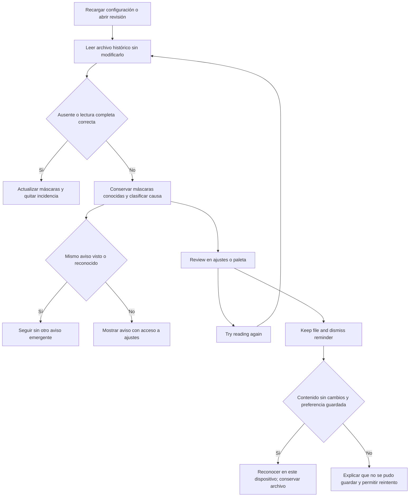

# Credenciales históricas: revisión del aviso — candidato 1.7.17

## Objetivo y diagnóstico

Encargo directo del 02/11/2026: usuarios que actualizan una bóveda antigua reciben repetidamente `historical output masking is unavailable or incomplete` al lanzar una tarea. El usuario confirma que la ejecución continúa. El aviso proviene del lector del almacén histórico retirado y se repetía con cada recarga de configuración; no era un rechazo de ejecución ni un fallo de autenticación del proveedor.

El formato `schemaVersion: 1`, con registros `encryptedValue` en base64, ya era compatible con el lector actual. No se ha demostrado una incompatibilidad de esquema ni una causa concreta de descifrado en las instalaciones remotas. La disponibilidad del almacén del sistema, las claves, el acceso al archivo y su estructura son causas distintas. La guía de recuperación se apoya en la [documentación de safeStorage de Electron](https://www.electronjs.org/docs/latest/api/safe-storage).

La solución añade una revisión dentro de ajustes y en la paleta de comandos. El usuario puede reintentar o conservar el archivo y descartar el recordatorio para ese contenido y causa en su dispositivo. Descartar no recupera credenciales ni restablece el ocultado que falta. La ejecución mantiene sus comprobaciones habituales.

## Flujo

## Contratos

- `LegacyMaskingIssue`: `id` opaco, `reason` (`storage-unavailable`, `decryption-failed`, `invalid-store`, `unreadable-store`), `acknowledged` y `dismissible`. No expone valores, registros, PIN, errores del sistema ni nombres de credenciales.
- Identidad de revisión: SHA-256 de ruta de instalación, causa y hash de los bytes originales. La preferencia local almacena únicamente una clave derivada de la ruta y esa identidad. No se guarda en `data.json` ni en el archivo de credenciales.
- `acknowledge(id)` vuelve a leer y comparar los bytes antes de guardar. Una incidencia obsoleta, archivo ilegible o escritura local fallida no se anuncia como reconocimiento correcto.
- `review-legacy-credential-notice`: comando de Obsidian; no es un nuevo endpoint ni comando de la CLI. La CLI autónoma sigue sin acceso al almacén cifrado.
- Sin cambios en modelos de tarea/workflow, importación/exportación, permisos, motores, autenticación, concurrencia ni prompt de creación. Se verifica el ejemplo efectivo del prompt compartido para ambos creadores y todos los motores en las pruebas existentes; no se cambia su guía por este aviso.

## Casos límite y supuestos

- Archivo ausente o `secrets: []`: ninguna incidencia. JSON inválido o registros no válidos: incidencia explícita, nunca catálogo vacío ni reescritura correctora.
- Archivo totalmente ilegible: deduplicación durante la sesión, sin reconocimiento persistente hasta poder identificar sus bytes.
- Descifrado parcial o fallo posterior: se conservan las máscaras conocidas de esa instalación durante la sesión y se incorporan los nuevos valores leídos. Una lectura completa correcta reemplaza la caché; no se comparte entre instalaciones.
- Recargar el plugin conserva el reconocimiento local; cambiar archivo, causa o instalación requiere revisión. Reintentar siempre vuelve a leer, incluso tras reconocer. La opción sigue disponible en ajustes mientras haya incidencia.
- Un archivo restaurado tras reconocer puede volver a la misma identidad: se conserva el reconocimiento de ese contenido y causa exactos. No hay reconocimiento global de todos los archivos futuros.
- Almacén local de preferencias no disponible: error visible, sin falso mensaje de éxito. No se incluyen excepciones sensibles en el diálogo.
- Los valores de menos de cuatro caracteres mantienen el comportamiento anterior. Este mecanismo no garantiza ocultar credenciales externas o valores que nunca ha podido descifrar.
- `requiresAutoOCSecrets` continúa siendo un contrato separado: una dependencia declarada del componente retirado sí rechaza la ejecución antes de efectos. Descartar este recordatorio no elude ese rechazo.
- No se han inspeccionado ni modificado las bóvedas de los usuarios afectados. No se atribuye a esas máquinas una causa criptográfica concreta.

## Validación y entrega

- Regresión focal: 58/58, incluidos lector histórico, preferencias, diálogo, Play y compatibilidad del ejemplo real de los creadores. Play usa un adaptador sintético: acredita que el aviso no bloquea la orquestación, no autenticación de un proveedor real.
- `npm test`: suite general 785 aprobadas, 3 omisiones (dos pruebas POSIX y la comprobación del binario oficial de OpenCode 2), 0 fallos; después, proceso aislado de ciclo de vida 149/149 sin otras suites ni empaquetados concurrentes.
- `npm run build`: TypeScript y los tres bundles correctos. Versiones 1.7.17 alineadas en manifiesto, paquete, lock y CLI.
- `npm run pack:release`: siete artefactos verificados. ZIP extraído y validado por su descriptor; consultas `version`, `help`, `list`, `status` y workflow autónomo sintético de dos pasos Code completado, con resultados `package-1717` y `package-1717-ok`.
- SHA-256 de `release/auto-oc-1.7.17.zip`: `2e8c5f5b2b8c9efb489d5aba46ef1eae93de5595a46ccf17254c383fb9d730a1`.
- Los siete blobs preparados en Git se extrajeron y verificaron contra su descriptor: hashes correctos tras la normalización de finales de línea.
- Revisión de impacto con CodeGraph: dependientes de configuración, tareas/workflows, salida, creadores y ciclo de vida. El índice también incluye copias temporales antiguas; las verificaciones se ejecutan contra las fuentes y bundles actuales.

Pendiente: aceptación visual en Obsidian real y validación por los usuarios afectados. El cifrado real de sus sistemas no se ha probado; las pruebas de descifrado utilizan proveedores sintéticos. No se ha publicado, etiquetado ni instalado en una bóveda de usuario. El paquete es un candidato local, no una actualización ya disponible desde `main`.
