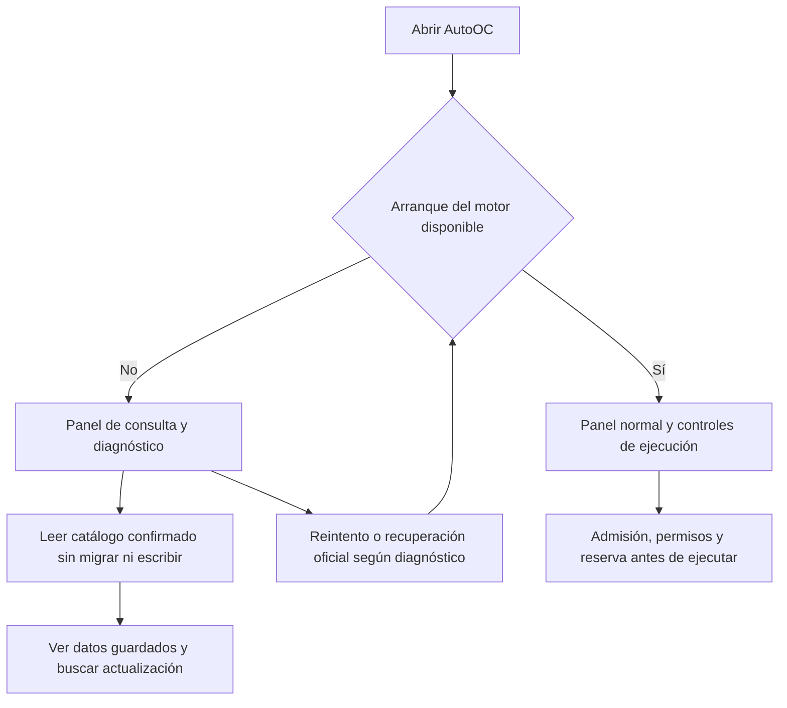
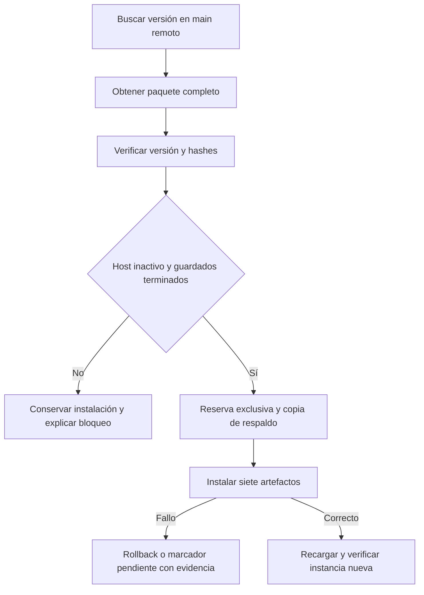
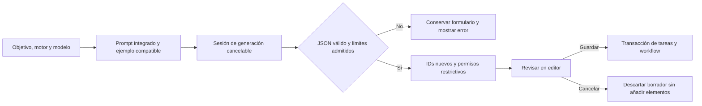
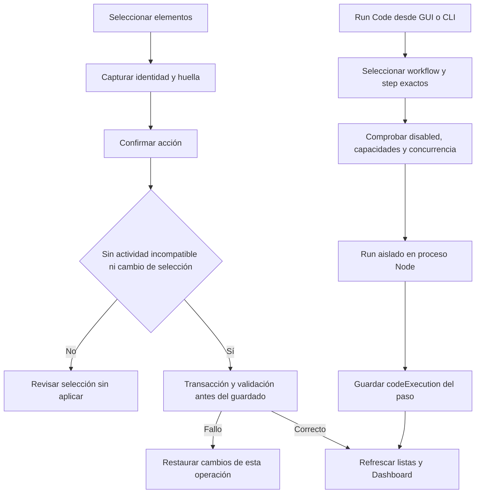
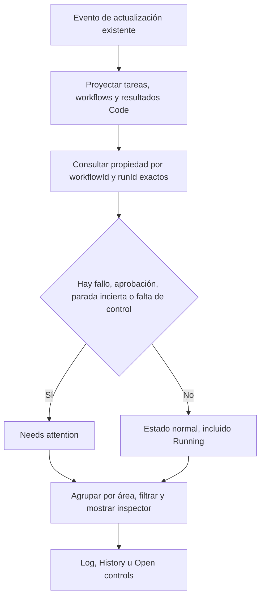

# Flujos modificados

## Consulta y ejecución separadas

El panel de consulta no inventa un catálogo vacío ante errores. No adquirir la reserva para leer tampoco concede permiso para ejecutar. El reintento no sustituye la recuperación ni resuelve efectos desconocidos.

## Actualización del paquete

Los históricos interrumpidos se conservan; no son por sí solos una operación de escritura actual. Un propietario vivo, guardado interrumpido o actualización incompleta sí impide sustituir archivos. `maintain-release --install` ofrece el recorrido desde un paquete nuevo separado cuando el actualizador instalado antiguo no permite el salto; nunca elimina reservas.

## Creación desde objetivo

La generación no inicia el objetivo descrito ni comparte el journal de una tarea. El workflow generado es secuencial; el importador general sigue admitiendo workflows existentes con otros recorridos.

## Operaciones de catálogo y Code

La eliminación comprueba referencias desde workflows no seleccionados. La ejecución aislada usa input y resultados previos vacíos, sin transiciones; no marca el workflow completo como terminado. Stop no revierte efectos externos.

## Dashboard por áreas y atención

`requiresReconciliation` es información durable; no basta para mostrar una alarma si el host controla ese intento. `disabled` es una dimensión separada del resultado. No se añade sondeo periódico ni movimiento físico continuo; los pasos se muestran en grupos de 40.
