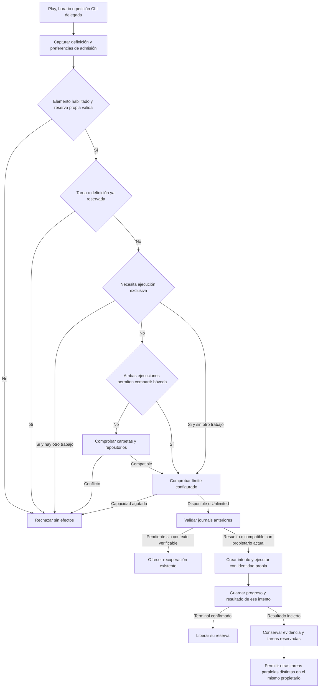

# Paralelismo dentro de la bóveda — candidato 1.7.16

## Solicitud y objetivo

Permitir lanzar varias tareas y workflows dentro de la misma bóveda, incluso con el mismo motor, sin el tope fijo de dos ejecuciones. El usuario concretó que el paralelismo debía ser el comportamiento predeterminado. La configuración permite limitarlo cuando se prefiera.

Los trabajos anteriores relacionados con recuperación se conservan en los expedientes 1.7.14 y 1.7.15. Este cambio no cierra sus intentos pendientes ni ejecuta tareas de una instalación real. No se ha iniciado un ciclo SDLC automático.

## Comportamiento

- Una política ausente hereda la bóveda: `parallel` y límite `0` (Unlimited) por defecto. Se conservan políticas explícitas existentes.
- `parallel` permite compartir carpeta/repositorio con otras ejecuciones paralelas. No aísla archivos ni concede permisos: las tareas de confianza deben coordinar sus salidas.
- `exclusive` exige ejecución en solitario; `independent` conserva las comprobaciones de espacios disjuntos. La política del workflow gobierna sus pasos; no paraleliza sus transiciones.
- No se ejecuta dos veces la misma tarea ni se comparte entre workflows concurrentes. Cada ejecución conserva identificadores, resultado, historial y parada propios.
- Las sesiones interactivas y los cambios declarados de rama Git siguen siendo exclusivos.
- El límite cuenta tareas y workflows del mismo propietario. Reducirlo no cancela trabajo existente; no hay cola ni reintentos automáticos. Los intentos retenidos cuentan para un límite finito.

## Flujo modificado

## Modelos y contratos

| Campo | Contrato |
| --- | --- |
| `concurrency` en tarea/workflow | Opcional: `exclusive`, `independent`, `parallel`; ausente hereda. Se conserva en importación/exportación. |
| `defaultConcurrency` en ajustes de bóveda | Misma enumeración; ausente equivale a `parallel`. |
| `maxConcurrentExecutions` en ajustes | Entero seguro no negativo. Ausente o `0`: sin límite AutoOC; positivo: capacidad máxima. Valores inválidos se rechazan. |
| `PreparedWorkflow.admissionSettings` | Captura inmutable de preferencias, separada del contenido que determina el hash histórico. La preparación asíncrona captura antes de ceder ejecución. |
| Descriptor local `concurrentExecutions` | Límite actual; `0` significa Unlimited. |
| Descriptor local `sharedWorkspaceConcurrency` | `true` identifica soporte de admisión en carpeta compartida. |

No hay endpoints de red, comandos CLI ni parámetros nuevos. El plugin propietario admite varias peticiones delegadas; varios procesos CLI autónomos no compiten por la misma instalación. Se conserva el protocolo de reserva. La preferencia no añade campos a los journals ni invalida hashes históricos; editar explícitamente la definición de una tarea sigue siendo un cambio de definición.

El botón Apply guarda un límite completo; escribir sus dígitos no dispara guardados sucesivos. Los editores exponen `Use vault default`, `Run alone`, `Parallel in this vault` y `Separate projects only`.

## Casos límite y supuestos

- `0` elimina el límite de admisión del plugin, no los límites de memoria, CPU ni proveedor.
- Dos tareas que escriben el mismo archivo pueden sobreescribirse. La coordinación de tareas de confianza no es aislamiento ni una ampliación de capacidades Code.
- Una política explícita antigua `independent` continúa siendo restrictiva. Para compartir bóveda debe elegirse la opción paralela o heredar.
- Un intento paralelo retenido solo deja pasar trabajo distinto si el propietario actual conserva su identidad, hash y recursos. No se considera cerrado ni se repite. Un journal desconocido o de otro propietario sigue requiriendo recuperación oficial, también tras reiniciar Obsidian.
- Un límite reducido por debajo de la ocupación actual rechaza nuevas admisiones, sin detener las existentes. Reanudar un intento retenido conserva su reserva y política original.
- Los errores de persistencia, cambios externos de catálogo, pérdida de reserva e identidades de rutas alteradas conservan sus controles.
- Instalar el candidato no cambia políticas explícitas, no concede permisos y no inicia tareas. Los ajustes se aplican a nuevas admisiones.

## Prompts de creación

Se revisaron el contrato incluido en `AUTOOC_WORKFLOW_PROMPT` y `buildDraftPrompt`. La guía describe las tres políticas; la solicitud de borrador exige omitir la política y los ajustes de bóveda para que el usuario conserve el control desde el editor. El analizador sigue descartando campos de configuración/runtime generados y mantiene los permisos Code desactivados.

## Validación

- `npm run build` y `npm run pack:release`: correctos; ZIP extraído con sus siete artefactos verificados.
- Casos nuevos: ocho tareas AI y tres workflows simultáneos por defecto dentro de la misma bóveda, salidas separadas, cancelación aislada, tarea retenida sin repetición, límite configurable y Unlimited, política explícita, importación/exportación y preferencias capturadas sin alterar hashes históricos.
- CLI: doce peticiones simultáneas en el arnés, actualización del límite anunciado, conservación de cancelación/recibos y exclusión para edición.
- Suite principal local: 774 aprobadas, 3 fallidas y 3 omitidas. Las tres fallidas esperaban el bloqueo global retirado; se actualizaron para comprobar ausencia de duplicados, reserva y no ejecución de identidades inexistentes. Las regresiones corregidas pasan después (dos controles Play y dos casos de runtime con su preparación Obsidian). La primera ejecución completa permanece registrada como fallida.
- Ciclo de vida local: 148/149. La prueba de observación cooperativa excedió el umbral temporal con 147,75 ms durante otra actividad local; repetida de forma aislada pasa con 23,34 ms, sin cambiar el umbral ni el producto. No se presenta la ejecución original como verde.
- Paquete extraído: workflow sintético completo de dos pasos JavaScript, resultado esperado y preferencias efectivas `parallel`/`0` comprobados desde su runtime distribuido.
- Instalación autorizada: mantenimiento oficial sin decisiones sobre ejecuciones; siete artefactos verificados y 432 archivos anteriores ajenos al paquete conservados byte a byte, con respaldo completo. La carga visual por el usuario queda separada.
- La ejecución multiplataforma del commit final se consulta en la [PR 54](https://github.com/juanpega/AutoOC_obisdian_extension/pull/54). Las pruebas usan bóvedas y proveedores sintéticos: no acreditan autenticación real ni aceptación visual en Obsidian. Construir y empaquetar no equivale a publicar.
