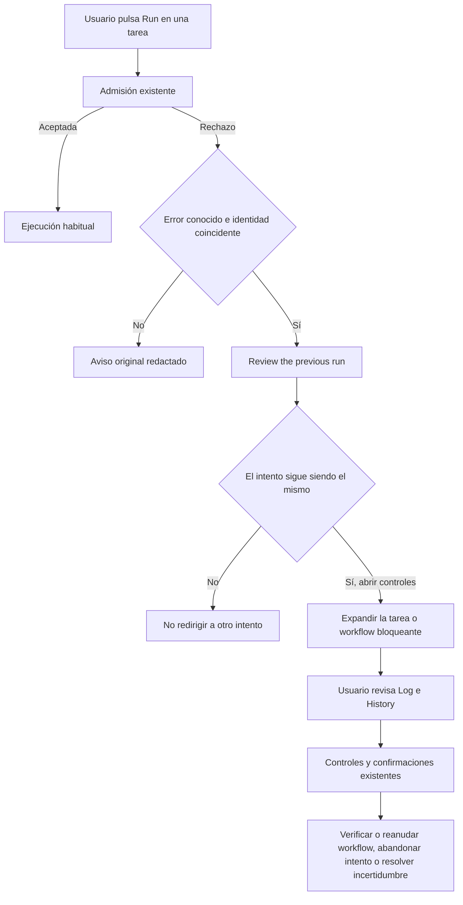

# Recuperación guiada al bloquear Run — candidato 1.7.14

## Objetivo y alcance

Encargo directo del 01/11/2026: ayudar a cualquier usuario instalado, sin solicitar la ruta de su bóveda, cuando un intento anterior impide iniciar una tarea. Base: `main` 54c8c43, después de la publicación de 1.7.13 y de la guía inglesa de actualización. No representa una ejecución del SDLC.

Antes, ambos botones Run de una tarea mostraban únicamente un aviso técnico. Un intento independiente en fase `ready` podía bloquear nuevas ejecuciones sin ofrecer `Abandon attempt`. Además, el intento bloqueante puede pertenecer a otro elemento: la admisión examina los journals de toda la instalación.

Ahora, un rechazo conocido y una identidad actual coincidente abren `Review the previous run`. La ayuda identifica la tarea o workflow bloqueante y permite abrir su tarjeta expandida, eliminando filtros que pudieran ocultarla. Explica las acciones existentes y sus consecuencias. Los intentos independientes `ready` e `in_flight`, sin propietario local y sin estado `running`, ofrecen `Abandon attempt`; los terminales no ofrecen esa operación.

## Flujo

Abrir la ayuda, copiar diagnósticos y navegar no ejecutan ninguno de los pasos de recuperación. Reanudar un workflow puede ejecutar pasos pendientes; abandonar o disponer un resultado desconocido no equivale a detener su proceso, deshacer sus efectos ni declarar éxito.

## Modelos y contratos

- No hay endpoints, comandos CLI, parámetros públicos ni migraciones nuevos. No cambia el esquema de tareas/workflows, el catálogo ni el journal.
- `ExecutionHelpSnapshot.reviewAction` es presentación en memoria: `abandon-attempt`, `resolve-uncertainty` o `workflow-controls`. No autoriza operaciones.
- `executionHelpContext` centraliza la lectura actual y la navegación. En el diálogo surgido de un rechazo, queda ligado al `runId` y `workflowId` observados; si cambian, deja de ofrecer la navegación.
- `showTaskStartFailure` reconoce los rechazos concretos ya emitidos por el runtime, valida sus identidades en el catálogo y conserva el Notice anterior para otros errores. No trata cualquier fallo del proveedor como un caso de recuperación.
- Las confirmaciones, razones, comprobación de inactividad, reservas, revisiones y operaciones durables de abandono/disposición permanecen en sus implementaciones existentes.
- Los prompts de creación se revisan por impacto: no hay cambio en esquema, modelos, motores, permisos ni salida generada que requiera modificarlos.

## Casos límite y supuestos

- Un bloqueo puede ser de otra tarea o workflow; se navega por identidades, nunca por similitud de nombres.
- Una tarea eliminada, un run reemplazado o un journal que ya no tiene correspondencia actual no se asocian a otro elemento. El caso sin correspondencia conserva su diagnóstico; esta versión no añade reparación de journals huérfanos.
- Un intento controlado por el host no recibe instrucciones de abandono. La ausencia de control en esta ventana no demuestra que haya terminado el proceso externo.
- La misma ayuda sigue disponible en tarjetas con problemas. Las tarjetas normales y las ejecuciones controladas no adquieren un aviso de atención nuevo.
- No se añade recuperación a lanzamientos automáticos ni a todos los tipos de aviso. Este cambio cubre los dos botones Run de las tarjetas de tareas y la ayuda existente.
- No se han leído ni cambiado catálogos de otras bóvedas, ni se ha ejecutado, abandonado o dispuesto un intento real.

## Validación y entrega

- Compilación TypeScript y bundles correcta.
- Regresiones focales: 34/34, cubren handlers de ambos botones Run, tareas `ready`, incertidumbre terminal, otro elemento bloqueante, filtros, identidad cambiada, ausencia de mutaciones y conservación de los controles existentes.
- Suite completa: primera pasada en una copia temporal de los archivos de Git con únicamente los cambios del candidato; quedan excluidas cinco modificaciones locales ajenas. Cuatro pruebas de transición histórica fallan porque `git archive` no incluye `.git`; esas mismas pruebas están incluidas y pasan en la tanda focal de 34 casos ejecutada en el repositorio. Resultado final pendiente de completar.
- Revisión final del texto de workflows: ambas opciones, verificar y reanudar, pueden continuar con pasos pendientes. Compilación y los 16 casos de ayuda pasan después de esta precisión; ZIP 1.7.14 generado localmente con los siete artefactos.
- El arnés UI carga el bundle real con dobles de Obsidian. No acredita presentación ni interacción en Obsidian real.
- Versión candidata 1.7.14; sin instalación, tag ni publicación. El ZIP publicado 1.7.13 se conserva.
