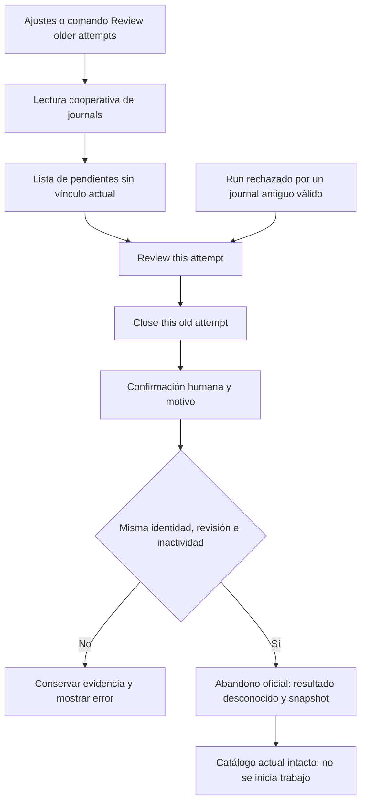

# Recuperación de intentos antiguos — candidato 1.7.15

## Objetivo

Petición directa: instalar una versión que permita al usuario desbloquear desde AutoOC un intento histórico que no coincide con el intento actual de la tarea. La revisión de 1.7.14 solo navegaba a vínculos actuales exactos; el nuevo recorrido contempla el journal antiguo sin reasignarlo a la tarjeta actual. No se ejecuta SDLC ni se recuperan intentos privados durante el desarrollo.

## Flujo

## Contratos y alcance

- `historical-execution-recovery.ts` inspecciona únicamente journals `ready` o `in_flight` sin referencias actuales en tareas, workflows o pasos Code. La lectura no recupera nada.
- La inspección guarda identidad física, run/workflow, revisión, definición y hash del checkpoint. Tras la confirmación se contrastan de nuevo bajo reserva y transacción del catálogo.
- La operación reutiliza `abandonInstalledExecution`: no introduce comandos CLI, endpoints, esquemas persistidos ni estados nuevos. El snapshot original y `outcome: unknown` siguen el contrato existente.
- No escribe `data.json` ni proyecta el intento antiguo sobre una tarea actual. Conserva intentos posteriores, desactivación, texto, configuración y resultados.
- La UI incorpora lista y revisión desde ajustes y paleta de comandos, sin necesitar lanzar una tarea. El rechazo conocido de Run puede llevar al mismo diálogo. Las lecturas de la lista son asíncronas y solo ocurren al solicitarla.
- La confirmación explica que debe comprobarse que el proceso original terminó; cerrar no detiene procesos, deshace efectos ni marca éxito. Exige un motivo y rechaza actividad, escrituras, cambios de identidad/revisión y pérdida de reserva.
- Los prompts de creación no requieren cambios: no se modifica el esquema generado, modelos, motores ni permisos.

## Validación y límites

- Focales de ayuda, abandono y ajustes: 42 casos aprobados. Incluyen cancelación, ready/in_flight, conservación byte a byte de catálogo e intento posterior, diagnósticos sin contenido privado y rechazo por revisión, vínculo, actividad, escritura, reserva o actualización cambiados.
- Se ejecutan además la suite completa y el build antes de instalar; sus resultados finales quedan en el PR y en el registro privado de acompañamiento.
- Las pruebas UI usan el bundle real con dobles de Obsidian; no equivalen a validación GUI humana. La prueba en la bóveda autorizada queda en manos del usuario.
- Los intentos terminales conservan sus mecanismos existentes. Un journal inválido o ausente no se puede cerrar con esta acción. No se recuperan automáticamente reservas ni se cierran todos los intentos en bloque.
- El paquete 1.7.14 previamente construido se conserva; esta ampliación se identifica como 1.7.15. La instalación autorizada y la publicación son operaciones distintas.
